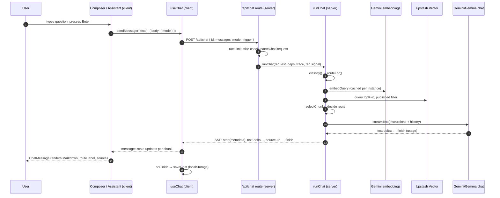

# AI Request Lifecycle

One question, from the click to the rendered answer. Each step names the file and function,
where it runs, its input/output, external calls, latency contributors and failure behaviour.

Legend: 🖥 client (browser) · ☁ server (Vercel function) · 🌐 external API.

> "Implemented" = in the code and covered by tests. Behaviour marked **(recommended)** does not
> exist yet. Latencies quoted are **single local measurements** taken on 2026-10-18 against the
> real Gemini API with Upstash not configured; they are not production statistics.

## The happy path

**Implemented architecture**

| # | Where | File / function | In → out | External | Latency contributors | Failure → behaviour |
|---|---|---|---|---|---|---|
| 1 | 🖥 | `ChatComposer.submit()` (`components/assistant/chat-composer.tsx`) | textarea → `onSend(text)` | — | — | Empty or `busy` → nothing happens |
| 2 | 🖥 | `Assistant.send()` (`assistant.tsx`) | text → `sendMessage({ text }, { body: { mode } })` + `trackEvent("chat_message_sent", {mode, length})` | GA/GTM (if configured) | — | `busy` → ignored (duplicate prevention) |
| 3 | 🖥 | `useChat` default transport | messages → `fetch("/api/chat")` | network | Round trip | Network failure → `error`, Retry banner |
| 4 | ☁ | `POST` (`app/api/chat/route.ts`) | Request → 500/429/413/400 JSON or SSE | Upstash Redis (rate limit) | Redis round trip (~ms) | See §4 below |
| 5 | ☁ | `parseChatRequest` (`lib/rag/validation.ts`) | body → `{ mode, question, history, previousQuestion }` | — | — | 400 `{ error }` |
| 6 | ☁ | `runChat` → `classify`, `routeFor` (`lib/rag/pipeline.ts`, `router.ts`) | query → intent → route | — | < 1 ms | blocked/greeting → fixed reply |
| 7 | ☁ | `retrieve` (`lib/rag/retrieve.ts`) | query → `{ chunks, topScore, candidates }` | 🌐 Gemini embeddings, 🌐 Upstash Vector | Embedding call + vector query (cache hit skips embedding); 8 s timeout | See §5 |
| 8 | ☁ | route decision (`runChat` lines 99–117) | route + chunks → final route | — | — | no_context / out_of_scope fixed replies |
| 9 | ☁ | `generate` → `streamText` (`pipeline.ts`) | instructions + history → text stream | 🌐 Gemini chat (+ Google Search on web route) | Prompt size (prefill), output length (decode), search | §4, §6 |
| 10 | ☁ | `toUIMessageStream` + writer | text parts → UI chunks (SSE) | — | — | errors → `error` chunk via `onError` |
| 11 | ☁ | `toSources` | chunks → `source-url` chunks | — | — | skipped on failure, empty answer, timeout |
| 12 | ☁ | `trace.end()` (`telemetry.ts`) | fields → one JSON log line | Vercel logs | — | — |
| 13 | 🖥 | `ChatMessage` (`chat-message.tsx`) | message parts + metadata → UI | — | Re-render per chunk | Markdown has no raw HTML |
| 14 | 🖥 | `onFinish` → `saveChat` (`lib/chat-history.ts`) | messages → localStorage | — | — | Skipped when `isError`; storage errors swallowed |

Observed locally: a personal question on the `fallback` route took **7.8 s** total
(2,174 input / 291 output tokens); a web-search question took **12.4 s** (375 / 429 tokens).

## Scenario 2 — RAG returns no relevant documents

**Implemented.** In `runChat`:
- **Personal question:** `chunks.length === 0` → `writeFixedReply(..., replies.noContext)`,
  route `no_context`. No model call. UI label "No matching information"; no sources.
- **Technical question:** route becomes `general`; the model answers from general knowledge with
  the instruction "say it isn't from Ayush's published content"; label "General knowledge";
  no sources.
- **Unknown question:** out-of-scope reply unless `topScore ≥ 0.7`.
Test: `tests/rag/pipeline.test.ts` "abstains on personal questions…", "answers technical
questions from general knowledge…".

## Scenario 3 — Web search is selected

**Implemented.** `classify` → `current` (technical vocabulary + words like *latest*, *release*,
a version number or a year) and mode ≠ `knowledge` → `web_search`; or mode `web` + technical.
`generate()`:
1. `deps.models({ webSearch: true })` → model with Google Search grounding.
2. `peekForError(start("web_search"))` reads until the first text delta or source.
3. Success → stream continues; `sendSources: true` forwards the provider's web sources (URLs are
   Google grounding redirect links). Portfolio chunks are **not** cited on this route.
4. Any error before output → retry without search, `searchUnavailable: true`, route
   `technical_rag` or `general`; the UI shows "Web search limit reached, so this answer uses my
   portfolio data only." (copy in `PORTFOLIO.chat.searchUnavailable`).
Latency: search adds a full search round trip before the first token (locally ~12 s total).

## Scenario 4 — Gemini returns a rate limit or provider error

| When | Implemented behaviour |
|---|---|
| Missing API key | Route returns **500** `{ error: notConfigured }` before streaming; UI shows "The assistant isn't configured yet…" (because `online` is false on the page) |
| Error **before** any output, normal route | `streamText` emits an `error` part → `toUIMessageStream` → `error` chunk with `userMessageFor(error)`: 429 → "usage limit was reached…", timeout → "took too long…", other → generic. HTTP status is still **200** (stream already started). `useChat` sets `error`; Retry banner shows the message. |
| Error on the web route before output | Retried once **without search** (Scenario 3). |
| Error **mid-stream** | Partial text stays visible; `error` chunk follows; no sources written. |
| Retries | `maxRetries: 1` for normal routes, `0` for web search (don't burn quota). |
Log: `error: "model_quota" | "model_provider" | "model_timeout"`.

## Scenario 5 — Vector database times out

**Implemented.** `withTimeout(..., 8000)` rejects with `TimeoutError` (the Upstash HTTP call
itself isn't cancelled; its result is ignored). `runChat` sets `retrievalFailed` and logs
`retrieval_timeout`. Personal → "knowledge base temporarily unavailable" fixed reply;
technical → `general` route; unknown → out-of-scope reply.
Test: `tests/rag/retrieve.test.ts` "times out instead of hanging…".

## Scenario 6 — Streaming stops midway

| Cause | Implemented behaviour |
|---|---|
| Model timeout (50 s, `modelTimeoutMs`) | Model stream aborts; `generate()` sees `timeout.aborted` → writes `error` chunk "The answer took too long. Please try again."; no sources. Test: "reports a timeout instead of silently truncating". |
| Model finishes with no text | `error` chunk `emptyAnswer`, log `model_empty`. This was a real bug: Gemma spent 998/1000 tokens on hidden reasoning; fixed with `thinkingLevel: "minimal"` and guarded by this check. |
| Function hits Vercel `maxDuration` (60 s) | Platform terminates the response. **Not handled in code**: the browser sees a broken stream; `useChat` reports an error. Kept unlikely by the 50 s model timeout. |
| Network drop | `useChat` error; partial text visible; Retry available. No resumable streams **(recommended only if needed)**. |

## Scenario 7 — The user clicks Retry

**Implemented.** The banner's Retry calls `regenerate({ body: { mode } })` (`assistant.tsx`).
`useChat` removes the last assistant message (if any) and re-sends the same history. On the
server it's a brand-new request (new request ID, counts towards the rate limit, new model call).
There's no idempotency key or response cache, so retries cost tokens.

## Scenario 8 — The user cancels

**Implemented.** Stop (`ChatComposer` → `onStop` → `useChat.stop()`) aborts the fetch. The
server's `req.signal` aborts, which is combined with the timeout signal and passed to
`streamText`, so the provider request is cancelled. `generate()` checks
`timeout.aborted && !abortSignal?.aborted`, so a user cancel is **not** reported as a timeout.
The partial answer remains in the UI; `onFinish` runs with whatever was received.
**Note:** an embedding/vector call already in flight completes in the background; only the
model call is cancelled.

## Pre-stream HTTP responses (for debugging)

| Status | Body | Cause |
|---|---|---|
| 500 | `{ "error": "The assistant isn't configured yet…" }` | `GOOGLE_GENERATIVE_AI_API_KEY` missing |
| 429 | `{ "error": "You're sending messages quickly…" }` + `Retry-After` | Rate limit |
| 413 | `{ "error": "Request too large." }` | Body > 100,000 characters |
| 400 | `{ "error": "Invalid request." }` or a specific message | JSON or schema failure |
| 200 | SSE stream | Everything else (including later errors, which arrive as `error` chunks) |
