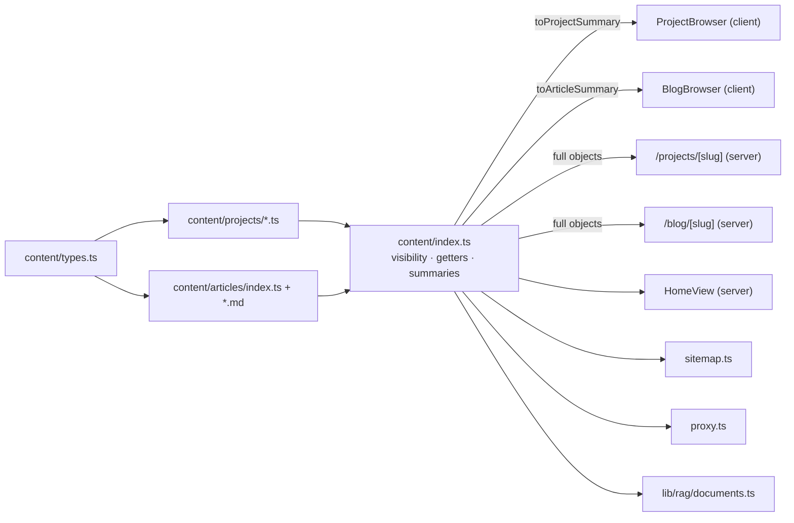
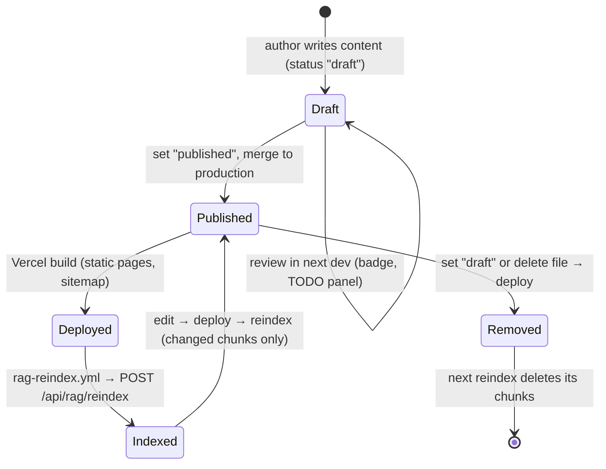

# Content Architecture

## 1. Representation

Content is **typed data in the repository**, separate from presentation.

| Kind | Files | Schema |
|---|---|---|
| Projects | `content/projects/<slug>.ts` (one export each), ordered in `PROJECTS` (`content/index.ts`) | `Project` in `content/types.ts` |
| Articles | Metadata in `content/articles/index.ts` (`ARTICLES`), body in `content/articles/<slug>.md` | `Article` in `content/types.ts` |
| Profile, experience, skills, education, AI journey, all UI copy | `lib/portfolio.ts` (`PORTFOLIO`) | Inferred from the `as const` object |

Key fields shared by projects and articles: `id` (stable, e.g. `project-fitshop`,
`article-how-llms-work`), `slug`, `title`, `summary`, `publicationStatus`, an evidence label
(`evidence` / `learningStatus`), `tags`, `updatedAt` (ISO date), `sourceUrls` (articles),
related links (`relatedArticles`, `relatedProjects`).

Project-only: `sections` (problem, challenge, contribution, architecture, decisions, tradeoffs,
limitations, impact, lessons — each Markdown **or `null`**), `todos`,
`stack`, `visual`, `links`. Rule: unknown facts are `null` + a TODO, never guessed.

Article bodies are plain Markdown imported as strings: `next.config.ts` has the Turbopack rule
`"*.md": { type: "raw" }`; TypeScript learns about it from `content/markdown.d.ts`; tests use
the equivalent plugin in `vitest.config.mts`.

Icons are names (`IconKey`), mapped to Lucide components in
`components/content/content-icon.tsx`, so content stays serialisable.

## 2. Status

| Status | Site (production) | `next dev` | Sitemap | Knowledge base | Detail page |
|---|---|---|---|---|---|
| `published` | ✅ | ✅ | ✅ | ✅ | ✅ |
| `draft` | ❌ (404 via `proxy.ts`) | ✅ with "Draft · not public" badge (+ TODO panel for projects) | ❌ | ❌ | dev only |
| `planned` | Listed under "Planned topics" (blog) | same | ❌ | ❌ | ❌ |

Implemented by `isVisible()` / `hasPage()` (`content/index.ts`), using
`process.env.NODE_ENV === "development"`. Current counts: projects 9 published / 6 draft;
articles 15 draft / 7 planned / **0 published**.

## 3. Rendering

**Implemented architecture**

- List pages pass **summaries** (no bodies, no functions) to client components.
- Detail pages render Markdown on the server (`components/content/markdown.tsx`).
- `generateStaticParams` prerenders every page with `hasPage()`; with Cache Components it must
  return at least one param, hence the `{ slug: "_none" }` placeholder (which 404s).
- `proxy.ts` returns a real 404 for any other slug **before** rendering (otherwise a streamed
  `notFound()` keeps HTTP 200 — documented Next.js behaviour).

## 4. Slugs and canonical URLs

- `projectHref(slug)` → `/projects/<slug>`; `articleHref(slug)` → `/blog/<slug>`.
- `SITE_URL` (`lib/site.ts`) = `NEXT_PUBLIC_SITE_URL` or `https://ayushpathak.co.in`;
  `absoluteUrl()` builds canonical URLs for metadata, sitemap, JSON-LD and RAG citations.
- Changing a slug changes the URL **and** the chunk hashes (URL is hashed), so the next reindex
  re-embeds that document; old links 404 (no redirects implemented).

## 5. SEO metadata

- `pageMetadata()` (`lib/seo.ts`): title, description, `alternates.canonical`, Open Graph
  (article fields for articles/projects), Twitter card, `noindex` for non-published items.
- `app/layout.tsx`: `metadataBase`, default title/description, authors.
- JSON-LD via `jsonLd()` (escapes `<`): `Person` (home), `CreativeWork` (projects),
  `TechArticle` (articles).
- `app/sitemap.ts`: static pages + published projects/articles; `app/robots.ts`: allow all,
  disallow `/api/`, sitemap link.
- **Not implemented:** Open Graph images, `BlogPosting` publish dates (only `dateModified`).

## 6. Internal linking

- Related links work in **both directions**: `relatedArticlesForProject()` includes articles
  listed in the project *or* articles that list the project; same for the reverse.
- Only items with a page are linked (`hasPage`), so drafts never appear as related links in
  production.
- "Ask AI" links (`askAssistantHref()`) on cards and detail pages open the assistant with a
  prepared question.

## 7. Adding content without touching components

- **Article:** create `content/articles/<slug>.md`, import it in `content/articles/index.ts`,
  add an `article({...})` entry. Categories and filters update automatically (the blog derives
  categories from the data).
- **Project:** create `content/projects/<slug>.ts` exporting a `Project`, add it to `PROJECTS`.
  The router learns its title and `aka` automatically.
- **Publish:** set `publicationStatus: "published"`, update `updatedAt`, deploy.

## 8. Lifecycle

**Implemented architecture** (the post-deploy reindex is implemented but not yet run)

Between "Deployed" and "Indexed", the page is live but the assistant doesn't know it yet; if
the reindex fails, the assistant stays stale (see [RAG_DEEP_DIVE.md](RAG_DEEP_DIVE.md) §F).
