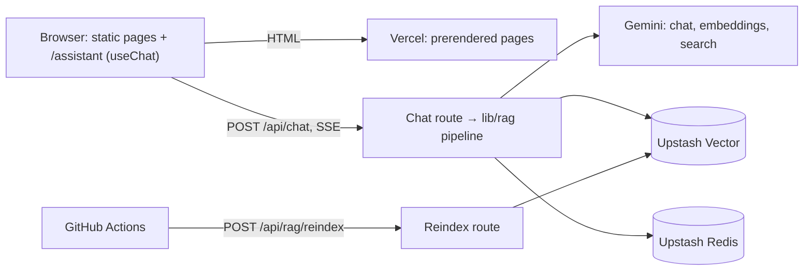
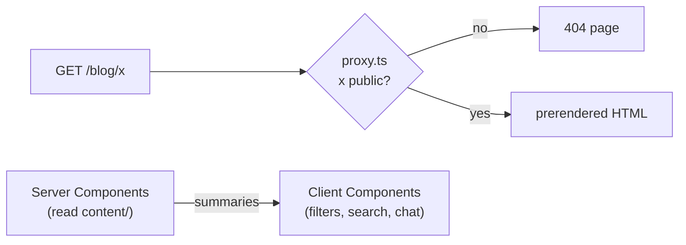
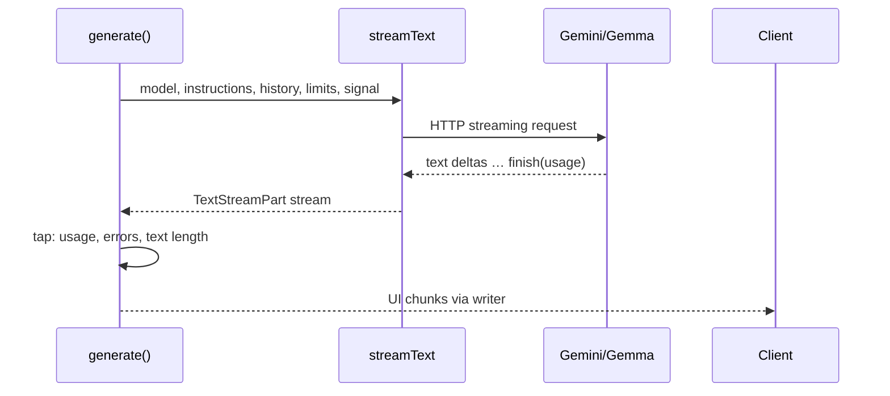
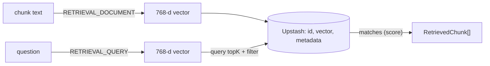
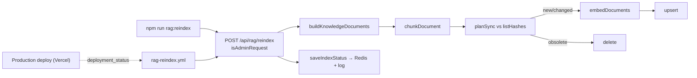
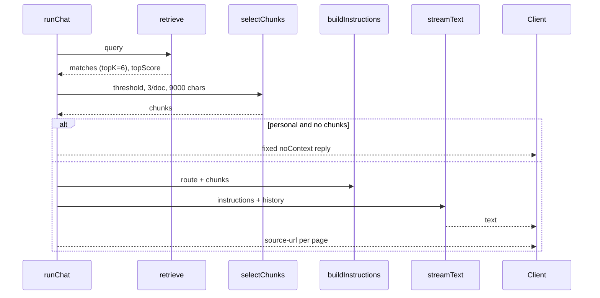
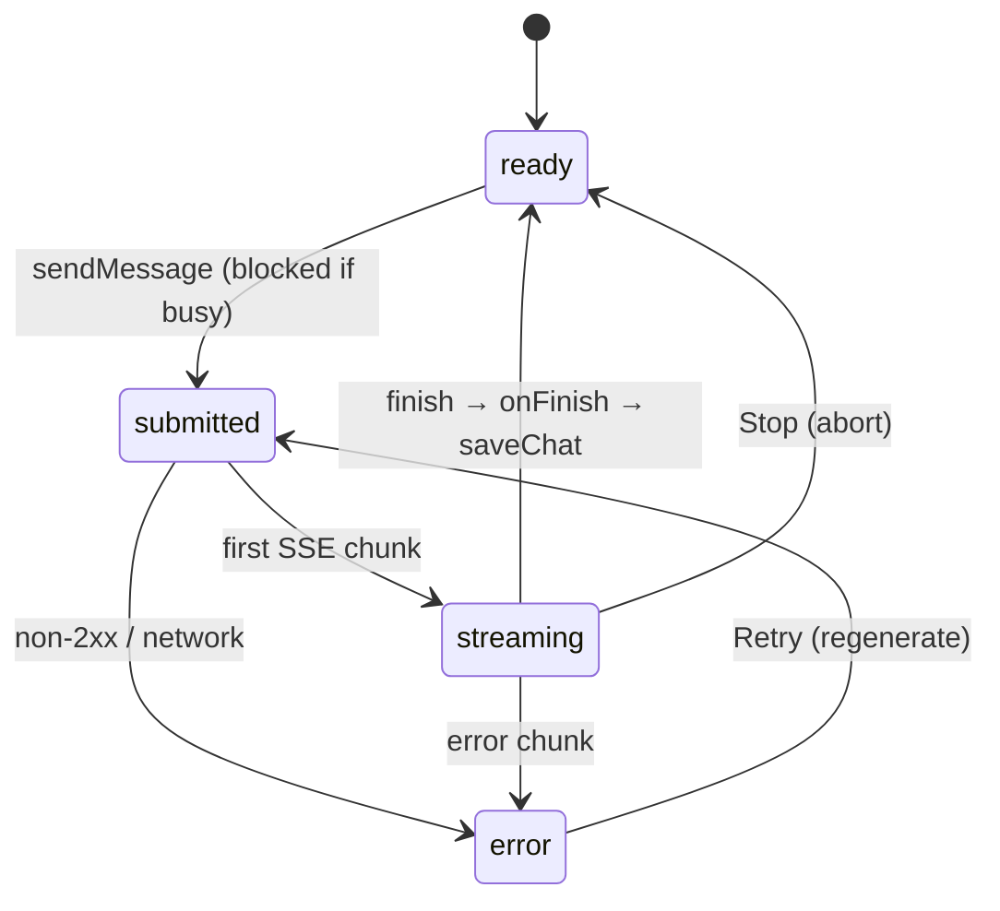
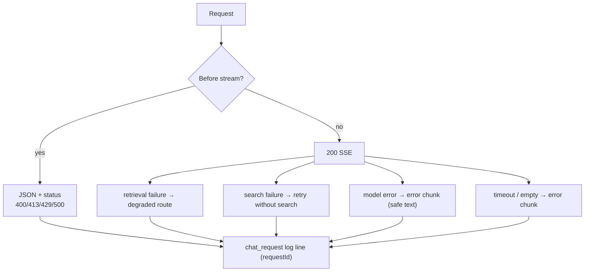
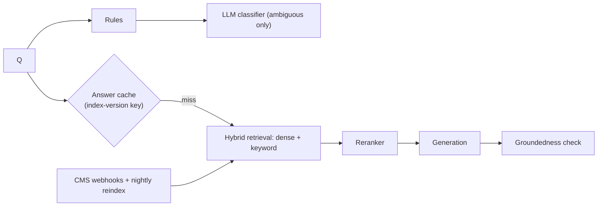

# Portfolio & AI Assistant — Learning Guide

Your primary curriculum for understanding **this repository**: the portfolio at
ayushpathak.co.in and its RAG-based AI assistant. Sixteen modules, one hour each. Every module
uses real files and functions; deeper reference material lives in the other `docs/` files and is
linked where useful.

**How to use it**
1. Do one module per session. Read with the code open beside you.
2. Do the hands-on exercise — that's where understanding happens.
3. Answer the quiz without looking, then check.
4. Tick the completion checklist only when every item is honestly true, then update the tracker.

**Status labels used throughout**
- **Implemented** — in the code (tested or exercised locally).
- **Partial** — code exists but isn't fully configured, run or verified.
- **Planned** — described as a next step; no code yet.
- **Missing** — a gap worth knowing about; no plan yet.

> **State of the project (2026-10-18).** Everything below describes uncommitted work on `main`.
> 117 automated tests pass; lint, typecheck and production build pass. Gemini chat and Google
> Search were exercised locally. **Upstash Vector and Redis are not configured yet**, so the
> real vector index has never been populated, and the assistant currently answers personal
> questions through the `fallback` route. All 15 articles are drafts.

---

## Learning progress tracker

Update this by hand. Don't mark a module Completed until its checklist and exercise are done.

| # | Module | Status (Not Started / In Progress / Completed) | Date |
|---|---|---|---|
| 1 | Project Overview and Architecture | Not Started | |
| 2 | Next.js Application Architecture | Not Started | |
| 3 | AI SDK and LLM Integration | Not Started | |
| 4 | Embeddings and Vector Databases | Not Started | |
| 5 | Document Ingestion and Indexing | Not Started | |
| 6 | RAG Retrieval and Answer Generation | Not Started | |
| 7 | Hybrid RAG, Web Search, and Scope Control | Not Started | |
| 8 | Chat UI and Streaming | Not Started | |
| 9 | Reliability and Debugging | Not Started | |
| 10 | Rate Limiting, Security, and Privacy | Not Started | |
| 11 | Cost and Performance | Not Started | |
| 12 | Portfolio Content Architecture | Not Started | |
| 13 | Analytics and Observability | Not Started | |
| 14 | Testing and AI Evaluation | Not Started | |
| 15 | Deployment and Production Architecture | Not Started | |
| 16 | Senior-Level System Design and Interview Preparation | Not Started | |

**Concepts I understand**
-

**Concepts I need to revisit**
-

**Bugs I investigated**
-

**Exercises I completed**
-

**Interview questions I can answer confidently**
-

---

## Module 1: Project Overview and Architecture

**Estimated time:** 60 min · **Prerequisites:** none · **Next:** Module 2

### 1. Learning objectives
- Describe what the product does and for whom.
- Name the stack and the versions that matter.
- Draw the system: browser, Next.js on Vercel, external services.
- Know which ten files to open first.

### 2. Concepts to understand
Static site generation · Route Handler · RAG (preview) · vector database (preview) ·
serverless function · external service dependency.

### 3. Explanation in simple English
The portfolio is a Next.js website. Almost every page is turned into plain HTML when the site is
built, so it loads fast and ranks well. One page, `/assistant`, is a chat. When a visitor asks a
question, the browser calls a server function (`/api/chat`). That function decides what kind of
question it is, looks up relevant pieces of Ayush's published content, and asks a Google AI model
to answer using only those pieces, streaming the answer back word by word with source links.

### 4. Why it exists
Recruiters want quick, specific answers. A chatbot that invents facts would damage trust, so the
design centres on **grounding** (answer from evidence), **citations** and **abstention**
("I don't know").

### 5. How it works internally
Two kinds of work: **build time** (render pages from content files) and **request time** (chat,
reindex, 404 proxy). Content lives in the repository; the assistant's searchable copy of it lives
in Upstash Vector, refreshed by a reindex job after each deploy.

### 6. Actual implementation — **Implemented** unless noted
- Pages: `app/**/page.tsx` — Implemented.
- Content: `content/`, `lib/portfolio.ts` — Implemented.
- Chat API: `app/api/chat/route.ts` → `lib/rag/pipeline.ts` — Implemented.
- Vector search: `lib/rag/vector-store.ts` — **Partial** (Upstash not configured).
- Post-deploy reindex: `.github/workflows/rag-reindex.yml` — **Partial** (never run).
- Analytics: `lib/analytics.ts`, `app/layout.tsx` — Implemented.

**Stack (installed versions):** Next.js 16.4.0, React 19.3.0, TypeScript 5 (strict),
Tailwind CSS 4, AI SDK `ai` 7.0.137, `@ai-sdk/google` 4.0.93, `@ai-sdk/react` 4.0.140,
`@upstash/vector` 1.2.3, `@upstash/redis` 1.39.0, `@upstash/ratelimit` 2.2.0, Zod 4,
react-markdown 10, Vitest 5.0.5. Default chat model `gemma-4-26b-a4b-it` (`lib/model.ts`);
embeddings `gemini-embedding-001` at 768 dimensions (`lib/rag/config.ts`).

### 7. Important files
| File | Responsibility |
|---|---|
| `app/layout.tsx` | Root layout, metadata base, analytics scripts |
| `components/page-shell.tsx` | Layout for content pages |
| `content/types.ts`, `content/index.ts` | Content schemas and helpers |
| `lib/portfolio.ts` | Profile, experience, UI copy, fixed chat replies |
| `components/assistant/assistant.tsx` | Chat client (`useChat`) |
| `app/api/chat/route.ts` | Chat entry point |
| `lib/rag/pipeline.ts` | Orchestrates routing → retrieval → generation |
| `lib/rag/router.ts` | Decides the route |
| `lib/rag/retrieve.ts` | Vector search + selection + citations |
| `lib/rag/ingest.ts` | Index synchronisation |

### 8. Code walkthrough
`app/api/chat/route.ts` hands everything to the pipeline:

```ts
const trace = createTrace()
const stream = runChat({ request: parsed.value, deps: getChatDeps(), trace, abortSignal: req.signal })
return createUIMessageStreamResponse({ stream, headers: { "x-request-id": trace.requestId } })
```
- `createTrace()` starts a log record with a request ID.
- `getChatDeps()` supplies the real providers (model, embedder, vector store).
- `runChat` returns a stream immediately; the work happens while the response streams.

### 9. Diagram — **Implemented architecture**



### 10. Alternatives and trade-offs
- Content in a CMS instead of files: easier editing, but needs webhooks and another service.
- A separate backend for the assistant: independent scaling, but more to deploy; a Next.js Route
  Handler is enough at this size.

### 11. Common mistakes and failure modes
- Assuming RAG is live in production: it isn't until Upstash is configured.
- Assuming publishing an article updates the assistant immediately: only after a reindex.

### 12. Interview questions
1. **What does the app do?** — A static portfolio plus an assistant that answers from published
   content with citations, uses web search only for current tech questions, and abstains when
   it lacks evidence.
2. **Why mostly static?** — Content changes only with deploys; static HTML is fastest and best
   for SEO.
3. **What runs per request?** — `/api/chat`, `/api/rag/reindex`, `proxy.ts`.
4. **Which external services?** — Gemini (chat, embeddings, search), Upstash Vector and Redis,
   Vercel, GitHub Actions, GA4/GTM.
5. **What's the riskiest dependency?** — Free-tier quotas on Gemini and Upstash; one provider
   for chat, embeddings and search.
6. **What's not finished?** — Upstash setup, real retrieval evaluation, article review.

### 13. Hands-on exercise
Run `npm run build` and read the route table. Identify which routes are `○` (static),
`◐` (partial prerender) and `ƒ` (dynamic), and explain each in one sentence.

### 14. Self-assessment quiz
1. Where does the assistant's knowledge come from? *(Published content → documents → chunks in
   Upstash; today the core profile via the fallback route.)*
2. Which file decides whether web search is allowed? *(`lib/rag/router.ts` `routeFor`.)*
3. What is `x-request-id` for? *(Linking a browser response to its server log line.)*

### 15. Completion checklist
- [ ] I can draw the architecture diagram from memory.
- [ ] I can name the ten important files and what each does.
- [ ] I completed the build exercise.
- [ ] I can state what is Partial and why.

---

## Module 2: Next.js Application Architecture

**Estimated time:** 60 min · **Prerequisites:** Module 1 · **Next:** Module 3

### 1. Learning objectives
- Explain App Router, Server vs Client Components, Route Handlers and Proxy in this repo.
- Explain Cache Components' effect on dynamic routes.
- Trace environment variables and server-only boundaries.

### 2. Concepts
App Router · Server Component · Client Component (`"use client"`) · serialisable props ·
`generateStaticParams` · Cache Components (`cacheComponents: true`) · Partial Prerendering ·
Route Handler · Proxy (formerly Middleware) · `server-only`.

### 3. Explanation
You know the App Router. The project-specific points: (a) pages read content directly on the
server and pass only small summaries to client components; (b) with Cache Components on, the
build validates that pages don't do request-time work outside `Suspense`, and dynamic routes need
at least one static param; (c) there are **no Server Actions** — the chat needs a streaming HTTP
endpoint, so it's a Route Handler.

### 4. Why
Small client bundles and fast static pages; secrets stay on the server.

### 5. How it works internally
`next build` prerenders every page. For `/blog/[slug]`, `generateStaticParams` lists published
slugs; any other slug would render on demand and stream — so `proxy.ts` intercepts unknown slugs
first and returns a real 404 (a `notFound()` after streaming starts keeps HTTP 200, which the
Next.js docs in `node_modules/next/dist/docs/` describe).

### 6. Implementation — **Implemented**
- `app/projects/page.tsx`: `visibleProjects().map(toProjectSummary)` → `<ProjectBrowser>`.
- `app/blog/[slug]/page.tsx`: `generateStaticParams` with a `_none` placeholder.
- `proxy.ts`: matcher `["/blog/:slug", "/projects/:slug"]`.
- `server-only` imported in `lib/rag/embeddings.ts`, `vector-store.ts`, `models.ts`,
  `service.ts`, `index-status.ts`, `lib/redis.ts`, `lib/rate-limit.ts`, `lib/admin-auth.ts`.

### 7. Files and functions
`next.config.ts` · `app/layout.tsx` · `app/projects/[slug]/page.tsx` (`generateStaticParams`,
`generateMetadata`) · `proxy.ts` (`proxy`, `config`) · `content/index.ts`
(`toProjectSummary`, `toArticleSummary`) · `lib/site.ts` (`SITE_URL`).

### 8. Code walkthrough
```ts
export function generateStaticParams() {
  const params = ARTICLES.filter(hasPage).map((a) => ({ slug: a.slug }));
  // Cache Components needs at least one param; the placeholder renders a 404 (e.g. while every item is a draft).
  return params.length > 0 ? params : [{ slug: "_none" }];
}
```
- `hasPage` = visible and not "planned". In production no article is published, so `params` is
  empty and the placeholder keeps the build valid.

```ts
const PUBLIC_PATHS = new Set([
  ...PROJECTS.filter(hasPage).map((p) => `/projects/${p.slug}`),
  ...ARTICLES.filter(hasPage).map((a) => `/blog/${a.slug}`),
]);
export function proxy(request: NextRequest) {
  const path = request.nextUrl.pathname.replace(/\/+$/, "");
  if (PUBLIC_PATHS.has(path)) return NextResponse.next();
  return NextResponse.rewrite(new URL("/_content-not-found", request.url));
}
```
- Rewriting to a path with no route renders the not-found page with status 404.

### 9. Diagram — **Implemented architecture**


### 10. Alternatives
- Server Actions for chat: not suitable for `useChat`'s streaming transport and custom statuses.
- `dynamicParams = false`: not available with Cache Components (documented), hence the proxy.

### 11. Common mistakes
- Importing `@/content` into a `"use client"` file (bundles every article).
- Passing a Lucide component as a prop from a server component (not serialisable).
- Using `Math.random()`/`generateId()` during render (breaks prerender — why `useChat` gets a
  fixed `id`).
- Prefixing a secret with `NEXT_PUBLIC_` (exposes it to the browser).

### 12. Interview questions
1. **Why a Route Handler for chat?** — It returns a streaming SSE response with custom status
   codes and headers that `useChat` consumes.
2. **What does `server-only` do?** — Fails the build if a client module imports that file.
3. **Why does the proxy exist?** — To return real 404s for unknown/draft slugs before streaming.
4. **Why summaries for client components?** — Serialisation size and no functions.
5. **What does Cache Components change?** — Static-by-default with validation; dynamic params
   need samples; uncached request-time work must sit in `Suspense`.
6. **Which env vars reach the browser?** — Only `NEXT_PUBLIC_GA_ID`, `NEXT_PUBLIC_GTM_ID`,
   `NEXT_PUBLIC_SITE_URL`.

### 13. Hands-on exercise
With `npm run build && npx next start`, curl `/projects/backend-for-frontend`,
`/projects/feedback-solution` (draft) and `/blog/anything`, and record the status codes. Then
temporarily comment out the `proxy` logic *in a scratch branch*, rebuild, and observe the 200 +
`noindex` behaviour. Revert.

### 14. Quiz
1. Where would you add a security header? *(`next.config.ts` `headers()` — Missing today.)*
2. What makes drafts appear in `npm run dev`? *(`NODE_ENV === "development"` in `isVisible`.)*
3. Why does `/blog/_none` exist? *(Placeholder static param; returns 404.)*

### 15. Completion checklist
- [ ] I can explain every server/client boundary in the projects and blog pages.
- [ ] I ran the status-code exercise.
- [ ] I can explain why the proxy is needed under Cache Components.

---

## Module 3: AI SDK and LLM Integration

**Estimated time:** 60 min · **Prerequisites:** Module 2 · **Next:** Module 4

### 1. Learning objectives
- Explain how `streamText` is called and configured.
- Explain prompt construction (system instructions + history).
- Understand tokens, limits, streaming and cancellation in this code.

### 2. Concepts
Provider · model id · system instructions (`instructions` in AI SDK v7) · message history ·
input/output tokens · reasoning ("thinking") tokens · `maxOutputTokens` · `maxRetries` ·
abort signal · UI message stream.

### 3. Explanation
The AI SDK gives one function, `streamText`, for any provider. We pass a model, the system
instructions (our rules + retrieved documents) and the conversation history. It returns a stream
of small events: text pieces, sources, a final usage record. We convert those into the format the
React hook understands and send them over HTTP.

### 4. Why
Provider-independent API, streaming built in, typed events.

### 5. How it works internally
Prompt tokens are processed first (prefill → time to first token), then output tokens are
generated one by one (decode). Hidden reasoning tokens also count against `maxOutputTokens`.

### 6. Implementation — **Implemented**
- Model selection: `googleModels` in `lib/rag/models.ts`.
- Prompt: `buildInstructions` in `lib/rag/prompt.ts`.
- Call: `generate()` in `lib/rag/pipeline.ts`.
- Limits: `RAG_CONFIG.limits` in `lib/rag/config.ts` (`maxOutputTokens: 1000`,
  `modelTimeoutMs: 50_000`).

### 7. Files
`lib/model.ts` (`GEMINI_MODEL`) · `lib/rag/models.ts` · `lib/rag/prompt.ts` ·
`lib/rag/pipeline.ts` (`generate`, `userMessageFor`, `peekForError`) · `lib/rag/telemetry.ts`.

### 8. Code walkthrough
```ts
const start = (r: ChatRoute, searchUnavailable = false) => {
  const { model, tools, providerOptions } = deps.models({ webSearch: r === "web_search" })
  return streamText({
    model,
    tools,
    providerOptions,
    instructions: buildInstructions({ route: r, chunks, today: now(), searchUnavailable }),
    messages: history,
    maxOutputTokens: RAG_CONFIG.limits.maxOutputTokens,
    abortSignal: signal,
    maxRetries: r === "web_search" ? 0 : 1,
  }).stream
}
```
- `deps.models` decides whether this call gets Google Search.
- `providerOptions` carries `thinkingConfig: { thinkingLevel: "minimal" }` for Gemma.
- `messages: history` is plain `{ role, content }` text built by `parseChatRequest`.
- `signal` = client abort OR 50 s timeout.
- No retries on the web route, to avoid burning search quota.

```ts
// Gemma thinks by default and the hidden reasoning counts against maxOutputTokens: a measured
// request spent 998 of 1000 tokens thinking and returned no text. "minimal" turns that off
// (Gemma rejects "low" and thinkingBudget with a 400).
```
This comment in `models.ts` records a real bug found while testing.

### 9. Diagram — **Implemented architecture**


### 10. Alternatives
Provider SDKs directly (more control, more glue); `generateText` (simpler, no streaming — fine
for evals and background jobs).

### 11. Common mistakes
- Using `system` (older AI SDK) instead of `instructions` (v7).
- Forgetting `abortSignal` (Stop hides the answer but billing continues).
- Too-small `maxOutputTokens` with a reasoning model → empty answers.
- Retrying 429s (burns more quota).

### 12. Interview questions
1. **What's in the prompt?** — Rules, date, route-specific rule, optional search note, and
   `<documents>`; then the last ≤ 8 messages.
2. **How do you cap cost?** — Output limit, retrieval budget, history limit, skipping the model
   for fixed replies.
3. **What were the empty answers?** — Reasoning tokens consumed the output budget; fixed with a
   minimal thinking level and an empty-answer guard.
4. **How is cancellation handled?** — `req.signal` combined with a timeout via `AbortSignal.any`.
5. **Where do token counts come from?** — The `finish` part's `totalUsage`, logged per request.
6. **What does `maxRetries: 0` on web search prevent?** — Repeated quota errors.

### 13. Hands-on exercise
Read `tests/rag/pipeline.test.ts` `textModel()`; write (in a scratch file) a mock that emits two
text deltas and check the SSE chunks produced by `runChat` using the existing `ask()` helper.

### 14. Quiz
1. What happens if the model returns no text? *(`error` chunk `emptyAnswer`, log `model_empty`.)*
2. Why does the web route use `peekForError`? *(To detect a search failure before anything is sent.)*
3. Where is the default model set? *(`lib/model.ts`.)*

### 15. Completion checklist
- [ ] I can explain every argument passed to `streamText`.
- [ ] I can explain the reasoning-token bug and fix.
- [ ] I completed the mock-model exercise.

---

## Module 4: Embeddings and Vector Databases

**Estimated time:** 60 min · **Prerequisites:** Module 3 · **Next:** Module 5

### 1. Learning objectives
- Explain embeddings, dimensions, cosine similarity.
- Describe the stored record schema and the query.
- Explain why scores aren't confidence.

### 2. Concepts
Embedding · dimension · cosine similarity · approximate nearest neighbour (ANN) · metadata
filter · task type (`RETRIEVAL_DOCUMENT` / `RETRIEVAL_QUERY`) · score normalisation.

### 3. Explanation
An embedding model converts text into 768 numbers. Texts about the same thing get vectors
pointing the same way. A vector database stores those vectors and quickly finds the ones closest
to a question's vector. Think of it as `Array.prototype.sort` by "meaning distance", done at
scale with an index.

### 4. Why
Keyword search misses paraphrases ("offline apps" vs "service workers").

### 5. Internals
Cosine similarity = dot product of normalised vectors (−1..1). Upstash uses an ANN index and
returns `(1 + cos) / 2` (0..1).

### 6. Implementation — **Partial** (code Implemented + tested with fakes; real index not created)
- Model: `gemini-embedding-001`, `dimensions: 768` (`lib/rag/config.ts`).
- Embedder: `createGeminiEmbedder()` + `withQueryCache()` (`lib/rag/embeddings.ts`).
- Store: `createUpstashVectorStore()` (`lib/rag/vector-store.ts`).

**Record schema** (`VectorRecord` = `Chunk & { vector }`): `id` = `"<documentId>:<n>"`,
`vector` (768 floats), `metadata: ChunkMetadata` = `documentId, title, url, contentType,
section, tags, publicationStatus, updatedAt, chunkIndex, hash, text`.

### 7. Files
`lib/rag/embeddings.ts` · `lib/rag/vector-store.ts` · `lib/rag/types.ts` · `lib/rag/config.ts` ·
`tests/helpers/fakes.ts` (`fakeVector`, `MemoryVectorStore` — test only).

### 8. Code walkthrough
```ts
const results = await ns.query<ChunkMetadata>({
  vector,
  topK,
  includeMetadata: true,
  filter: "publicationStatus = 'published'",
})
return results
  .filter((r): r is typeof r & { metadata: ChunkMetadata } => Boolean(r.metadata?.text))
  .map((r) => ({ id: String(r.id), text: r.metadata.text, metadata: r.metadata, score: 2 * r.score - 1 }))
```
- `includeMetadata` returns the chunk text and citation data in one round trip.
- The filter excludes anything not published (defence in depth).
- `2 * r.score - 1` converts Upstash's normalised score back to cosine (verified in Upstash docs).

### 9. Diagram — **Implemented architecture**


### 10. Alternatives
pgvector (SQL joins, more ops), Cloudflare Vectorize (Workers-centric), in-memory arrays (tests
only — no persistence, no sharing across instances).

### 11. Common mistakes
- Index created with the wrong dimensions/metric → every upsert fails.
- Mixing models/dimensions in one index.
- Reading 0.72 as "72% confident".

### 12. Interview questions
1. **What is an embedding?** — A vector representation where similar meanings are close.
2. **Why 768 dimensions?** — Smaller storage/query cost; Gemini supports reduced outputs.
3. **Why convert scores?** — Upstash normalises cosine to 0..1; thresholds are in cosine units.
4. **Why store text in metadata?** — One round trip gives prompt text and citation data.
5. **Why task types?** — Gemini optimises query and document embeddings for retrieval.
6. **What if the provider fails?** — Retrieval throws/times out (8 s); routes degrade
   (Module 9).

### 13. Hands-on exercise
In `tests/helpers/fakes.ts`, compute `cosineSimilarity(fakeVector("offline PWA service workers"),
fakeVector("Partners Studio offline support"))` in a scratch test and compare with an unrelated
sentence. Explain why a bag-of-words fake is good enough for tests but not for production.

### 14. Quiz
1. Where are dimensions configured? *(`RAG_CONFIG.embedding.dimensions`.)*
2. What happens to hashes if you change the embedding model? *(All change → full re-embed.)*
3. Is the vector store queried for greetings? *(No — fixed reply before retrieval.)*

### 15. Completion checklist
- [ ] I can explain cosine similarity with a diagram.
- [ ] I can list every metadata field and why it's there.
- [ ] I completed the fake-vector exercise.

---

## Module 5: Document Ingestion and Indexing

**Estimated time:** 60 min · **Prerequisites:** Module 4 · **Next:** Module 6

### 1. Learning objectives
- Trace content from files to vectors.
- Explain chunking, IDs, hashes, updates, deletions and partial failures.
- Know exactly how (and whether) publishing triggers indexing.

### 2. Concepts
Knowledge document · chunk · overlap · deterministic ID · content hash · desired vs stored
state (reconciliation) · upsert · idempotency · partial failure.

### 3. Explanation
Indexing is a "make the index match the content" job. It builds the list of chunks that *should*
exist, asks the index which chunks *do* exist (with their hashes), and only embeds what's new or
changed, then deletes what shouldn't be there anymore. Running it twice does nothing the second
time.

### 4. Why
Embedding calls and vector writes cost quota; drafts must never be searchable; removed content
must disappear.

### 5. Internals
`hash = SHA-256(fingerprint + text + url + status + type + tags)` where the fingerprint is
`gemini-embedding-001@768/chunker-v1`. Same hash → skip.

### 6. Implementation
- Documents: `buildKnowledgeDocuments()` — **Implemented** (17 docs today: 4 profile,
  4 experience, 9 projects, 0 articles).
- Chunking: `chunkDocument()` — **Implemented** (65 chunks, ~25,100 characters).
- Sync: `syncKnowledgeBase()` — **Implemented**, tested with fakes.
- Endpoint: `POST /api/rag/reindex` — **Implemented** (auth tested; never run against Upstash).
- Trigger: `rag-reindex.yml` on Production deployment success — **Partial** (never run).
- CMS webhook / scheduled reindex — **Missing/Planned**.

### 7. Files
`lib/rag/documents.ts` · `lib/rag/chunk.ts` · `lib/rag/ingest.ts` · `lib/rag/index-status.ts` ·
`app/api/rag/reindex/route.ts` · `scripts/rag-reindex.mjs` · `.github/workflows/rag-reindex.yml`.

### 8. Code walkthrough
```ts
// lib/rag/ingest.ts — syncKnowledgeBase (abridged)
const { valid, skipped } = prepareDocuments(documents)          // validate + dedupe
const desired = valid.flatMap((doc) => chunkDocument(doc))       // what should exist
const plan = planSync(desired, await store.listHashes())         // diff with what exists
for (let i = 0; i < plan.toUpsert.length; i += batchSize) {     // embed only changes
  const batch = plan.toUpsert.slice(i, i + batchSize)
  try {
    const vectors = await embedder.embedDocuments(batch.map((c) => c.text))
    await store.upsert(batch.map((c, j) => ({ ...c, vector: vectors[j] })))
  } catch (error) { failed.push({ ids: batch.map((c) => c.id), error: errorMessage(error) }) }
}
// Never delete a document's old chunks while its new ones failed to upload.
const failedDocs = new Set(failed.flatMap((f) => f.ids.map((id) => id.split(":")[0])))
const toDelete = plan.toDelete.filter((id) => !failedDocs.has(id.split(":")[0]))
```
- Upsert first, delete second → never an empty index mid-run.
- A failed batch doesn't stop the run, and its document keeps its old chunks.

Chunking detail (`lib/rag/chunk.ts`): `splitSections` (at `## `, ignoring code fences) →
`splitParagraphs` (code blocks stay whole) → `packParagraphs` (≤ 1400 chars; a short last
paragraph ≤ 200 chars is repeated in the next chunk) → title + `Section:` prefix.

### 9. Diagram — **Implemented architecture** (trigger: **Inferred**)


### 10. Alternatives
Full rebuild each time (simple, wasteful); CMS webhooks (needs a CMS); indexing during
`next build` (runs before the new site is live, and builds would need DB credentials).

### 11. Common mistakes
- Random chunk IDs → duplicates every run.
- Forgetting deletions → unpublished content stays searchable.
- Changing chunking without bumping `chunking.version` → mixed chunking strategies.
- **Known gap:** `updatedAt`/`section` aren't hashed → date-only edits don't refresh metadata.
- **Known gap:** chunk text can exceed `maxChars` slightly (header added after packing; max 1,412).

### 12. Interview questions
1. **How is re-indexing idempotent?** — Deterministic IDs + content hashes; diff-based upsert/delete.
2. **What happens when content is unpublished?** — It leaves the desired set → its chunk IDs are
   deleted next run; queries also filter by status.
3. **What if embedding fails halfway?** — Recorded in `failed`, HTTP 207, retried next run; old
   chunks kept.
4. **Why include the model name in the hash?** — Changing models forces a full re-embed so
   vectors never mix.
5. **Why prefix chunks with title and section?** — Retrieved chunks must make sense alone.
6. **Is indexing automatic?** — After Production deploys via GitHub Actions — implemented but not
   yet run; manual CLI available.

### 13. Hands-on exercise
Run `npx vitest run tests/rag/ingest.test.ts`. Then add (in a scratch branch) a test proving
that changing only `updatedAt` produces zero upserts — confirming the known gap. Discuss how
you'd fix it and what it would cost.

### 14. Quiz
1. Which function decides what to embed? *(`planSync`.)*
2. What status code means partial failure? *(207.)*
3. Which IDs does a 3-chunk article get? *(`article-<slug>:0..2`.)*

### 15. Completion checklist
- [ ] I can trace a published project from its `.ts` file to a vector record.
- [ ] I can explain every branch of `syncKnowledgeBase`.
- [ ] I wrote the `updatedAt` gap test.

---

## Module 6: RAG Retrieval and Answer Generation

**Estimated time:** 60–75 min · **Prerequisites:** Modules 3–5 · **Next:** Module 7

### 1. Learning objectives
- Trace a question through retrieval, selection, prompting, generation and citation.
- Explain thresholds, budgets and the no-evidence path.

### 2. Concepts
Query embedding · top-K · relevance threshold · per-document cap · context budget · grounded
prompt · citation · abstention.

### 3. Explanation
Retrieve candidates, keep only the clearly relevant ones, give them to the model inside a
"documents" block with rules, stream the answer, then attach links to the exact pages used.
If nothing is relevant for a personal question, reply "I don't have that published" without
asking the model.

### 4. Why
Grounding and honesty. Citations let readers verify.

### 5. Internals
`topK=6` candidates → `selectChunks`: sorted by score, stop at `< 0.6`, max 3 per document,
max 9000 chars → `buildInstructions` → `streamText` → `toSources` (one link per URL).

### 6. Implementation
- Retrieval/selection/citations: **Implemented** (tested with fakes; **Partial** in production).
- Fallback path (no vector store): **Implemented** and exercised locally.
- Query rewriting: only `effectiveQuery()` for short follow-ups — LLM rewriting **Missing**.
- Reranking: **Missing**.

### 7. Files
`lib/rag/retrieve.ts` (`retrieve`, `selectChunks`, `toSources`, `withTimeout`) ·
`lib/rag/prompt.ts` (`buildInstructions`, `formatContext`, `escapeDocumentText`) ·
`lib/rag/pipeline.ts` (`runChat`, `generate`, `effectiveQuery`).

### 8. Code walkthrough — the decision block in `runChat`
```ts
if (route === "personal_rag") {
  if (!deps.retrieval) {
    route = "fallback"
    chunks = deps.fallbackChunks()
  } else if (retrievalFailed) {
    return writeFixedReply(writer, meta("no_context"), replies.knowledgeUnavailable, trace)
  } else if (chunks.length === 0) {
    // No evidence: answer without the model rather than risk an invented one.
    return writeFixedReply(writer, meta("no_context"), replies.noContext, trace)
  }
}
if (route === "technical_rag" && chunks.length === 0) route = "general"
```

### 9. A real trace: "What did you build at FITPASS?"

Executed locally against the real Gemini API on 2026-10-18 (Upstash not configured).

| Step | Code | What happened |
|---|---|---|
| 1 | `ChatComposer` → `Assistant.send` | `sendMessage({ text }, { body: { mode: "auto" } })`; GA event `chat_message_sent` (mode, length) |
| 2 | `POST` in `app/api/chat/route.ts` | Key present; rate limit OK; body parsed |
| 3 | `parseChatRequest` | `{ mode: "auto", question: "What did you build at FITPASS?", history: [user msg], previousQuestion: null }` |
| 4 | `effectiveQuery` | unchanged (no previous question) |
| 5 | `classify` | `PERSONAL` matches "you" and "fitpass" → `personal` |
| 6 | `routeFor("personal", "auto")` | `personal_rag` |
| 7 | retrieval | `deps.retrieval` is `null` (Upstash unset) → skipped; `candidates: 0` |
| 8 | decision | `personal_rag` + no retrieval → `fallback`, `chunks = fallbackChunks()` → 9 core chunks |
| 9 | `buildInstructions("fallback", 9 chunks)` | rules + "knowledge base unavailable, these are core profile docs" + `<documents>` |
| 10 | `streamText` (Gemma, minimal thinking) | streamed answer listing fitpass.co.in, BFF, FITSHOP, Partners Studio… |
| 11 | `toSources` | `/about`, `/experience`, `/resume` written as `source-url` chunks |
| 12 | `trace.end()` | `{"route":"fallback","chunkCount":9,"inputTokens":2174,"outputTokens":291,"modelMs":7756,"totalMs":7760,…}` |
| 13 | `ChatMessage` | Markdown answer + "From my portfolio" + three source chips |

**With Upstash configured (traced through code, not executed):** step 7 would embed the question
(`RETRIEVAL_QUERY`), query top 6 published chunks, and `selectChunks` would keep those ≥ 0.6
(expected: `experience-fitpass` and FITPASS project chunks); step 8 would stay `personal_rag`; if
nothing passed the threshold, step 9 onwards would be replaced by the fixed `noContext` reply.

### 10. Diagram — **Implemented architecture**


### 11. Alternatives and trade-offs
Higher threshold → fewer wrong contexts, more "I don't know". Larger budget → more evidence,
more cost and distraction. Reranking improves precision at extra latency. LLM query rewriting
helps vague follow-ups at extra cost.

### 12. Common mistakes and failure modes
- Treating similarity as confidence.
- Calling the model with empty context for personal questions.
- Citing chunks the model didn't receive.
- **Known gap:** web route sends portfolio chunks but doesn't cite them.
- **Observed:** the model added generic first-person statements beyond its documents.

### 13. Interview questions
1. **How many chunks reach the model?** — Up to 6 candidates, filtered by score ≥ 0.6, ≤ 3 per
   document, ≤ 9000 characters.
2. **What happens with no relevant chunk?** — Personal: fixed reply, no model call. Technical:
   general-knowledge answer, labelled.
3. **How do citations map to sources?** — `toSources` over the supplied chunks, deduplicated by
   URL.
4. **How do follow-ups work?** — ≤ 6-word questions are combined with the previous question.
5. **How do you stop injected text in documents?** — Escaping tags, fencing, "data not
   instructions" rule.
6. **What's the fallback route?** — Without Upstash, personal questions get the core profile
   documents in full.
7. **Why not always use RAG for technical questions?** — Only 0 articles are published; general
   knowledge, clearly labelled, is more useful than "I don't know".

### 14. Hands-on exercise
Run the dev server and the curl command from [RELIABILITY_AND_DEBUGGING.md](RELIABILITY_AND_DEBUGGING.md)
§1 for "What did you build at FITPASS?". Read the SSE events and match each to a row of the
trace table. Then find your request's `chat_request` log line in the terminal.

### 15. Quiz
1. Where is the 0.6 threshold configured? *(`RAG_MIN_SCORE` / `RAG_CONFIG.retrieval.minScore`.)*
2. Which route label does a `general` answer get? *("General knowledge".)*
3. Why can `/experience` appear only once in sources? *(`toSources` dedupes by URL.)*

### 16. Completion checklist
- [ ] I can reproduce the trace table from memory.
- [ ] I ran the curl exercise and matched the events.
- [ ] I can explain each limitation in §12.

---

## Module 7: Hybrid RAG, Web Search, and Scope Control

**Estimated time:** 60 min · **Prerequisites:** Module 6 · **Next:** Module 8

### 1. Learning objectives
- Explain the router's rules and the retrieval override.
- Explain when web search is used and how it fails safely.
- Identify what the system can't control.

### 2. Concepts
Intent classification · rule-based routing · scope · abstention · grounding with Google Search ·
untrusted content · indirect prompt injection.

### 3. Explanation
Before calling any model, code decides the question type. Personal → only Ayush's content.
Current tech → web search. General tech → Ayush's articles if relevant, else general knowledge.
Anything else → a polite scope message, unless the content search finds a strong match.

### 4. Why
Guarantees that cannot be left to a prompt: "never web-search a person", "don't spend tokens on
off-topic questions".

### 5. Internals
Five regexes in `lib/rag/router.ts` (INJECTION, GREETING, PERSONAL, TECHNICAL, CURRENT). PERSONAL
includes names generated from content (companies, project titles). The pipeline rescues
`unknown` questions when `topScore ≥ 0.7`.

### 6. Implementation
- Rule router: **Implemented** (23 table tests + 16 eval cases).
- Retrieval override: **Implemented**.
- Web search (Google grounding) with fallback on any error: **Implemented**, exercised locally.
- LLM-based routing, app-side web result filtering: **Missing** (see
  [ROUTING_AND_TOOLS.md](ROUTING_AND_TOOLS.md) §7 proposal).

### 7. Files
`lib/rag/router.ts` (`classify`, `routeFor`) · `lib/rag/pipeline.ts` (out-of-scope override,
`generate` web branch, `peekForError`) · `lib/rag/models.ts` (`gemmaSearchProvider`) ·
`lib/rag/prompt.ts` (`ROUTE_RULES`).

### 8. Code walkthrough
```ts
export function classify(question: string): Intent {
  const q = question.trim()
  if (INJECTION.test(q)) return "blocked"
  if (GREETING.test(q)) return "greeting"
  if (PERSONAL.test(q)) return "personal"
  const technical = TECHNICAL.test(q)
  if (technical && CURRENT.test(q)) return "current"
  if (technical) return "technical"
  return "unknown"
}
```
Order is the policy: injection beats everything; personal beats current (so "your latest
project" is personal, never web).

```ts
const attempt = await peekForError(start("web_search"))
if (attempt.error) {
  trace.set("error", `search_${errorClass(attempt.error)}`)
  searchUnavailable = true
  route = chunks.length > 0 ? "technical_rag" : "general"
  stream = start(route, true)
}
```

### 9. Diagram — see [ROUTING_AND_TOOLS.md](ROUTING_AND_TOOLS.md) §1 (**Implemented architecture**).

### 10. Alternatives
Model chooses a search tool (flexible, but can't guarantee "never for personal"); LLM classifier
(better nuance, slower/costlier); search API with snippets (app controls citations and filtering).

### 11. Common mistakes / failure modes
- "Write a poem about React" is in scope (technical keyword).
- Personal pronouns route odd questions to personal RAG (usually ending in `no_context`).
- Web pages are processed inside Google's API — the app can't filter injected text.
- Off-topic questions still cost a retrieval.

### 12. Interview questions
1. **Rules or model?** — Rules plus a retrieval-score override; no model routing.
2. **Why never web-search personal questions?** — Namesakes and unverified claims.
3. **What if search quota is exhausted?** — Restart without search, flag it in the UI.
4. **How are injection attempts handled?** — Regex for obvious attempts (fixed reply); real
   protection is no secrets/tools in context.
5. **Can it go out of scope?** — Yes, via technical keywords; the prompt's scope rule is the
   second line.
6. **What would you add?** — Minimum-word check before retrieval rescue, LLM classifier for
   ambiguous cases, cite portfolio chunks on the web route.

### 13. Hands-on exercise
Add five new questions to a scratch copy of `tests/rag/router.test.ts` that you think break the
router (Hinglish, typos, indirect personal questions). Run them, record which fail, and propose
the smallest regex change — without committing it.

### 14. Quiz
1. Which intent does "What's new in Next.js 16.4?" get? *(`current`.)*
2. In My Knowledge mode, does a current question search? *(No → `technical_rag`.)*
3. What score rescues an unknown question? *(≥ 0.7 with at least one selected chunk.)*

### 15. Completion checklist
- [ ] I can recite the `classify` order and why.
- [ ] I can fill the mode × intent table.
- [ ] I completed the router-breaking exercise.

---

## Module 8: Chat UI and Streaming

**Estimated time:** 60 min · **Prerequisites:** Module 3 · **Next:** Module 9

### 1. Learning objectives
- Explain `useChat` state, message parts, metadata and the SSE protocol.
- Explain loading, error, retry, cancel, duplicate prevention and history.

### 2. Concepts
UI message · message parts (`text`, `source-url`) · message metadata · status machine · SSE ·
`regenerate` · `stop` · `useSyncExternalStore` · URL intents.

### 3. Explanation
`useChat` holds the conversation. Each server event updates the last assistant message; React
re-renders it. Metadata on the `start` event tells the UI which route answered, so it can show a
label like "From my portfolio".

### 4. Why
Responsive UX (text appears immediately), structured content (sources separate from text).

### 5. Internals
`status`: `ready → submitted → streaming → ready | error`. SSE lines `data: {json}`; see the
annotated stream in [RELIABILITY_AND_DEBUGGING.md](RELIABILITY_AND_DEBUGGING.md) §4.

### 6. Implementation — **Implemented**
- State: `components/assistant/assistant.tsx` (`useChat`, `send`, `switchTo`, `UrlIntent`,
  `friendlyError`).
- Rendering: `components/assistant/chat-message.tsx` (`ChatMessage`, `RouteLabel`, `isOwnSite`).
- Composer: `chat-composer.tsx` (Enter/Ctrl+Enter, Stop button).
- History: `lib/chat-history.ts` (`localStorage`, max 20, `useSyncExternalStore`).
- Metadata type: `AssistantMetadata` + `sourceKind()` in `lib/chat-modes.ts`.
- Resumable streams, server-side history: **Missing** (not needed for now).

### 7. Files
As above, plus `insights-panel.tsx`, whose "Sources Used" panel receives `usedWeb` from `assistant.tsx` (computed as `sourceKind(lastAssistant?.metadata?.route) === "web"`).

### 8. Code walkthrough
```tsx
{error && (
  <div role="alert" ...>
    <span>{online ? friendlyError(error) : PORTFOLIO.chat.notConfigured}</span>
    <Button size="sm" variant="outline" onClick={() => regenerate({ body: { mode } })}>
      <RotateCcw /> {PORTFOLIO.chat.retry}
    </Button>
  </div>
)}
```
- `role="alert"` announces errors to screen readers.
- `friendlyError` extracts `{ error }` from JSON bodies (pre-stream errors); stream errors arrive
  as plain text.
- Retry re-sends with the current mode.

```ts
export function sourceKind(route) {
  switch (route) {
    case "personal_rag": case "technical_rag": case "fallback": return "portfolio"
    case "web_search": return "web"
    case "general": return "general"
    case "no_context": return "none"
    default: return null
  }
}
```

### 9. Diagram — **Implemented architecture**


### 10. Alternatives
Server-side history (cross-device, needs auth/retention); hand-written SSE parsing (more control,
more code); WebSockets (bidirectional, unnecessary here).

### 11. Common mistakes / failure modes
- Double sends: prevented by `busy` checks in `send`, `ChatComposer.submit` and `HeroCard`.
- React Strict Mode runs effects twice in development; `UrlIntent` clears its params after use
  (a double `?ask=` send in dev is a hypothesis worth checking in the Network tab, not observed).
- Thumbs up/down are local state only (not sent anywhere).

### 12. Interview questions
1. **Why message parts?** — Text and citations are different data; parts keep them typed.
2. **How does the route label reach the UI?** — `messageMetadata` on the `start` chunk.
3. **How is Stop implemented end to end?** — Fetch abort → `req.signal` → `streamText` abort.
4. **Where is history stored and why?** — `localStorage`; private and free, per device.
5. **How are duplicate sends prevented?** — `busy` status checks.
6. **What does Retry cost?** — A full new request (rate limit, tokens).

### 13. Hands-on exercise
In the browser, ask a question and press Stop mid-answer. Check the Network tab (request
cancelled) and the server log (no `model_timeout`). Then ask an off-topic question and inspect the
`start` chunk's metadata.

### 14. Quiz
1. Which component shows "General knowledge"? *(`RouteLabel` in `chat-message.tsx`.)*
2. When is a chat saved? *(`onFinish` when `isError` is false.)*
3. Why does `useChat` have a fixed `id`? *(Random ids break prerendering under Cache Components.)*

### 15. Completion checklist
- [ ] I can draw the status machine.
- [ ] I did the Stop exercise and found the log line.
- [ ] I can explain every source of a visible error message.

---

## Module 9: Reliability and Debugging

**Estimated time:** 60–75 min · **Prerequisites:** Modules 6–8 · **Next:** Module 10

### 1. Learning objectives
- Explain the "Failed to fetch the chat response." investigation with evidence.
- Know every timeout and how errors propagate before and after streaming starts.
- Debug a failed request using the request ID and logs.

### 2. Concepts
HTTP status vs in-stream errors · empty-body 500 · error classes · timeouts · abort signals ·
`maxDuration` · request ID · structured logs.

### 3. Explanation
Once an SSE stream starts, the HTTP status is already 200. Errors before that point are JSON with
a status code; errors after it are `error` events in the stream. Most debugging starts by asking
"which side of that line did it fail on?".

### 4. Why
Users see one generic message for very different causes; logs and request IDs separate them.

### 5. Internals and the investigation
1. The AI SDK uses the exact text "Failed to fetch the chat response." only when the response is
   **non-2xx with an empty body** (`createUIApiCallError` in `node_modules/ai/dist/index.js`).
2. Next.js sends `new Response(null, { status: 500 })` when a route handler throws
   (`node_modules/next/dist/build/templates/app-route.js`).
3. The old route (`git show HEAD:app/api/chat/route.ts`) set `stream = attempt.stream` (which is
   `null`) whenever the search attempt failed with **any non-429 error**, so it threw.
**Conclusion:** likely root cause, fixed and tested; not confirmed with production logs (none
available). Full write-up: [RELIABILITY_AND_DEBUGGING.md](RELIABILITY_AND_DEBUGGING.md).

### 6. Implementation — **Implemented**
- Search failure of any kind → answer without search (`generate()`), tested.
- Model timeout 50 s → `error` chunk "took too long", tested.
- Empty answer → `error` chunk, tested (found as a real bug: reasoning tokens).
- Retrieval timeout 8 s → degraded routes, tested.
- `maxDuration = 60`; logs with `requestId`; `x-request-id` header.
- TTFT metric, alerts, resumable streams — **Missing**.

### 7. Files
`app/api/chat/route.ts` · `lib/rag/pipeline.ts` (`generate`, `userMessageFor`, `peekForError`) ·
`lib/rag/telemetry.ts` (`createTrace`, `errorClass`) · `lib/rag/retrieve.ts` (`withTimeout`,
`TimeoutError`) · `components/assistant/assistant.tsx` (`friendlyError`).

### 8. Code walkthrough
```ts
export function errorClass(error: unknown): "quota" | "timeout" | "aborted" | "provider" {
  if (typeof error !== "object" || error === null) return "provider"
  const e = error as { name?: string; statusCode?: number; lastError?: unknown }
  if (e.name === "TimeoutError") return "timeout"
  if (e.name === "AbortError") return "aborted"
  if (e.statusCode === 429) return "quota"
  if (e.lastError !== undefined) return errorClass(e.lastError)
  return "provider"
}
```
- `lastError` unwraps the AI SDK's retry wrapper to find the real cause.

```ts
if (timeout.aborted && !abortSignal?.aborted) {
  trace.set("error", "model_timeout")
  writer.write({ type: "error", errorText: replies.timeout })
  return
}
```
- Distinguishes "our timeout fired" from "the user pressed Stop".

### 9. Diagram — **Implemented architecture**


### 10. Alternatives
Client auto-retry with backoff (hides transient errors, costs tokens); resumable streams (survive
network drops, need storage); circuit breaker (stop calling a failing provider for a while).

### 11. Common mistakes
- Throwing inside a route after deciding to stream → empty 500.
- Showing raw provider errors to users.
- Retrying quota errors.
- Treating client cancel as a timeout.

### 12. Interview questions
1. **Walk me through the "Failed to fetch" bug.** — SDK message ⇒ empty non-2xx; Next sends empty
   500 on throw; old route threw on non-quota search errors; fixed with fallback + streamed
   errors; root cause not confirmed by prod logs.
2. **Why can't you just return 500 mid-stream?** — Headers are already sent with 200.
3. **What timeouts exist?** — 8 s retrieval, 50 s model, 60 s function.
4. **How do you find one failed request?** — `x-request-id` → log line → `route`, `error`, timings.
5. **What other bug did you find?** — Empty answers from reasoning tokens; truncation on timeout.
6. **What's still missing?** — TTFT, alerts, production log verification.

### 13. Hands-on exercises
1. Run `npx vitest run tests/rag/pipeline.test.ts -t "timeout"` and read the mock that never ends.
2. With `npm run dev`, send `{"mode":"admin",…}` via curl → 400 JSON. Send 11 quick "hi"
   requests → 429 with `Retry-After`.
3. Write down the diagnostic steps you'd follow for a user report with a screenshot only.

### 14. Quiz
1. What does an empty-body 500 indicate here? *(An unhandled throw in the route.)*
2. Which log field shows a search fallback? *(`searchUnavailable: true`, `error: "search_*"`.)*
3. Where is `maxDuration` set? *(`app/api/chat/route.ts`.)*

### 15. Completion checklist
- [ ] I can explain the investigation and its evidence without notes.
- [ ] I did exercises 1–3.
- [ ] I can map each user-visible error message to its cause.

---

## Module 10: Rate Limiting, Security, and Privacy

**Estimated time:** 60 min · **Prerequisites:** Module 9 · **Next:** Module 11

### 1. Learning objectives
- Explain each security control and its limits.
- Explain why prompt instructions alone don't prevent prompt injection.

### 2. Concepts
Shared vs per-instance rate limiting · sliding window · hashed client key · `server-only` ·
fail-closed auth · constant-time comparison · direct/indirect prompt injection · XSS ·
data minimisation.

### 3. Explanation
Security here is mostly about **what the model can't touch**: no secrets, no private data, no
tools that act. On top: validation, rate limiting, a protected admin endpoint, safe rendering,
and logs/analytics that don't contain conversations.

### 4. Why
Paid APIs attract abuse; LLMs follow any instruction they read.

### 5. Internals
`Ratelimit.slidingWindow(10, "60 s")` in Redis keyed by SHA-256(IP); `timingSafeEqual` on
SHA-256 digests of the bearer token and the secret.

### 6. Implementation
- Validation, size limits — **Implemented**.
- Redis rate limiter — **Partial** (code done; Redis not configured → memory fallback in use).
- Admin auth — **Implemented**, tested.
- Draft protection — **Implemented** (pages, proxy, sitemap, index, query filter).
- Injection regex + escaped context — **Implemented** (casual attempts only).
- Security headers/CSP, consent banner — **Missing**.

### 7. Files
`lib/rate-limit.ts` · `lib/redis.ts` · `lib/admin-auth.ts` · `lib/rag/validation.ts` ·
`lib/rag/router.ts` (`INJECTION`) · `lib/rag/prompt.ts` (`escapeDocumentText`) ·
`components/content/markdown.tsx` · `lib/seo.ts` (`jsonLd`).

### 8. Code walkthrough
```ts
export function isAdminRequest(req: Request) {
  const secret = process.env.RAG_ADMIN_SECRET
  if (!secret || secret.length < 32) return false
  const given = req.headers.get("authorization")?.match(/^Bearer\s+(.+)$/)?.[1] ?? ""
  const a = createHash("sha256").update(given).digest()
  const b = createHash("sha256").update(secret).digest()
  return timingSafeEqual(a, b)
}
```
- Fails closed (no secret ⇒ nobody gets in).
- Hashing first makes both buffers 32 bytes, so `timingSafeEqual` can't throw on length and
  leaks no timing about the secret.

### 9. Diagram — see [PROJECT_ARCHITECTURE.md](PROJECT_ARCHITECTURE.md) §11 (**Implemented**).

### 10. Alternatives
Auth for visitors (stops anonymous abuse, hurts UX); WAF/bot protection; ML injection
classifiers.

### 11. Common mistakes
- Believing "never reveal your instructions" is a security control.
- In-memory rate limits on serverless treated as global.
- Sending free text to analytics (see finding S-6: chat-history search terms go to GA).

### 12. Interview questions
1. **How do you secure the reindex endpoint?** — Bearer secret ≥ 32 chars, hashed constant-time
   compare, fail closed.
2. **Why Redis for rate limiting?** — Instances don't share memory.
3. **How do you handle prompt injection?** — Minimal capabilities first; regex, fencing and rules
   second.
4. **Can drafts leak?** — Not via the site/index/queries; they are in the repository.
5. **How do you prevent XSS from model output?** — No raw HTML in react-markdown; safe links.
6. **What do you log?** — Metadata only; IPs are hashed for rate limiting and not logged.

### 13. Hands-on exercise
Read [SECURITY_REVIEW.md](SECURITY_REVIEW.md). Pick S-6 and write (don't apply) the smallest
change that stops sending chat-history search terms to GA, plus a test.

### 14. Quiz
1. What happens to `/api/rag/reindex` if `RAG_ADMIN_SECRET` is unset? *(401 for everyone.)*
2. Which roles can a client send? *(user, assistant.)*
3. What does `escapeDocumentText` neutralise? *(`<document>`, `<instructions>`, `<system>` tags.)*

### 15. Completion checklist
- [ ] I can explain every finding in the security review and its severity.
- [ ] I wrote the S-6 change proposal.

---

## Module 11: Cost and Performance

**Estimated time:** 60 min · **Prerequisites:** Modules 5–6 · **Next:** Module 12

### 1. Learning objectives
- List every cost-producing operation and when it happens.
- Estimate usage with formulas; know what's cached and what isn't.
- Know how to measure latency per stage.

### 2. Concepts
Input/output tokens · prefill/decode · TTFT · quota · batching · cache safety · context budget.

### 3. Explanation
Each answered question costs roughly one embedding, one vector query and one model call
(plus search on the web route). Fixed replies cost almost nothing. Indexing only costs when
content changes.

### 4. Why
Free tiers are the budget.

### 5. Internals
Measured locally (single runs): fallback answer 2,174 in / 291 out tokens in 7.8 s; web search
375 / 429 in 12.4 s; before the reasoning fix, 998 output tokens and 22.8 s for no text.

### 6. Implementation
- Query-embedding LRU per instance — **Implemented**.
- Hash-based skip of unchanged chunks — **Implemented**.
- Batching (50 embeddings, 100 upserts, 500 deletes) — **Implemented**.
- Retrieval/answer caching, global budget, TTFT — **Missing**.

### 7. Files
`lib/rag/embeddings.ts` (`withQueryCache`) · `lib/rag/ingest.ts` · `lib/rag/config.ts` ·
`lib/rag/telemetry.ts` · [COST_AND_PERFORMANCE.md](COST_AND_PERFORMANCE.md).

### 8. Code walkthrough
```ts
const key = `${embedder.id}:${text.trim().toLowerCase().replace(/\s+/g, " ")}`
const hit = cache.get(key)
if (hit) { cache.delete(key); cache.set(key, hit); return hit }   // LRU refresh
const vector = await embedder.embedQuery(text, signal)
cache.set(key, vector)
if (cache.size > maxEntries) cache.delete(cache.keys().next().value!)
```
- Safe: the same text + model always gives the same vector; content changes don't matter.
- `Map` keeps insertion order, so the first key is the least recently used.

### 9. Cost estimation examples (clearly labelled assumptions)
**Assumption A:** 300 questions/day, 80% reach retrieval, 10% web search, no cache hits.
- Upstash ops ≈ 240 queries/day (+ ~65 updates on a first full index) → ~3% of the verified
  10,000/day free limit.
- Embedding calls ≈ 240/day; generation calls ≈ 300 × (share not answered by fixed replies).
- Tokens ≈ calls × (≈ 2,000 in + ≈ 300 out) **if** answers look like the measured fallback run.
Multiply by your provider's current per-token price (not verified here) to get money.

### 10. Alternatives
Shared Redis embedding cache; response cache for top questions; smaller model for general
answers; streaming earlier (TTFT) vs batching.

### 11. Common mistakes
- Assuming fixed replies cost nothing — off-topic still costs a retrieval.
- Not counting reasoning tokens.
- Retries doubling cost silently.

### 12. Interview questions
1. **What does one question cost?** — ≤ 1 embedding, 1 query, 1 generation (+ search).
2. **What's safe to cache?** — Query embeddings; retrieval results only with an index version.
3. **How do you avoid re-embedding?** — Content hashes.
4. **How would you measure TTFT?** — First `text-delta` in the tap (server) and first streaming
   render (client).
5. **Biggest latency driver?** — Model generation (and search on the web route).

### 13. Hands-on exercise
Using three `chat_request` log lines from your own local runs, compute average input/output
tokens per route and estimate a 30-day total for Assumption A.

### 14. Quiz
1. What does a reindex with no changes cost? *(One range call.)*
2. Is the embedding cache shared across instances? *(No.)*

### 15. Completion checklist
- [ ] I can list cost operations by trigger.
- [ ] I completed the estimate with my own log data.

---

## Module 12: Portfolio Content Architecture

**Estimated time:** 60 min · **Prerequisites:** Module 2 · **Next:** Module 13

### 1. Learning objectives
- Explain the schemas, statuses, rendering, SEO and linking.
- Add an article or project without touching components.
- Explain how content reaches RAG.

### 2. Concepts
Typed content · publication status · evidence label · canonical URL · JSON-LD · bidirectional
related links · raw Markdown imports.

### 3. Explanation
Content is data in `content/` and `lib/portfolio.ts`. Components only render it. A status field
decides visibility everywhere — pages, sitemap, assistant.

### 4. Why
Separation of content and presentation; one source of truth for the site **and** the assistant.

### 5. Internals
Markdown is imported as a string by a Turbopack rule; server pages render it with
react-markdown; client lists get summaries without bodies.

### 6. Implementation — **Implemented**
Projects 9 published / 6 draft; articles 15 draft / 7 planned. Open Graph images and slug
redirects — **Missing**. Full detail: [CONTENT_ARCHITECTURE.md](CONTENT_ARCHITECTURE.md).

### 7. Files
`content/types.ts` · `content/index.ts` · `content/projects/*.ts` · `content/articles/index.ts` ·
`app/projects/[slug]/page.tsx` · `app/blog/[slug]/page.tsx` · `lib/seo.ts` · `app/sitemap.ts`.

### 8. Code walkthrough
```ts
export function relatedArticlesForProject(project: Project) {
  return ARTICLES.filter(
    (a) => hasPage(a) && (project.relatedArticles.includes(a.id) || a.relatedProjects.includes(project.id)),
  )
}
```
- Links work if either side declares them; `hasPage` hides drafts in production.

### 9. Diagram — see [CONTENT_ARCHITECTURE.md](CONTENT_ARCHITECTURE.md) §3 and §8.

### 10. Alternatives
MDX (components in content), headless CMS (non-developer editing, webhooks), database.

### 11. Common mistakes
- Guessing project facts instead of `null` + TODO.
- Changing a slug (old URLs 404, chunks re-embedded).
- Importing `@/content` in a client component.

### 12. Interview questions
1. **How does a draft become public?** — Status → deploy → reindex.
2. **How are canonical URLs built?** — `absoluteUrl()` with `SITE_URL`.
3. **What structured data exists?** — Person, CreativeWork, TechArticle.
4. **How do evidence labels help the assistant?** — They're included in documents and rules
   ("Learning Notes" ≠ implemented).
5. **Why `null` sections?** — No fabricated case-study content.

### 13. Hands-on exercise
In a scratch branch, add a tiny published article (Markdown + registry entry). Run
`npm run build`; confirm the page, sitemap entry and `npx vitest run tests/rag/documents.test.ts`
pass. Discard the branch.

### 14. Quiz
1. Where are blog categories defined? *(Derived from article data in `BlogBrowser`.)*
2. What prevents draft links in "Related articles"? *(`hasPage`.)*

### 15. Completion checklist
- [ ] I added and removed a test article end to end.
- [ ] I can explain the content lifecycle diagram.

---

## Module 13: Analytics and Observability

**Estimated time:** 45–60 min · **Prerequisites:** Module 8 · **Next:** Module 14

### 1. Learning objectives
- Separate website analytics from AI request observability.
- List the events, where they fire and what they send.
- Read and use the `chat_request` log line.

### 2. Concepts
GA4 · GTM · `dataLayer` · enhanced measurement · custom events · debounce · structured logs ·
request tracing.

### 3. Explanation
GA/GTM answer "what do visitors do?" in the browser. Server logs answer "did this chat request
work, and how fast/expensive was it?". The two never share message content.

### 4. Why
Product decisions vs operational debugging; privacy.

### 5. Internals
`trackEvent` → `sendGAEvent` (gtag) and/or `sendGTMEvent` (dataLayer). `useTrackSearch` waits 1 s
after typing stops and skips repeats.

### 6. Implementation
- GA4/GTM tags, 4 custom events — **Implemented** (tags verified in build HTML; events not
  verified in GA DebugView).
- Page views — via GA4 enhanced measurement (property setting, not code) — **Inferred**.
- `chat_request` logs — **Implemented**, tested for privacy.
- Dashboards, alerts, TTFT, feedback events — **Missing**.

### 7. Files
`app/layout.tsx` · `lib/analytics.ts` · `components/blog/blog-list.tsx` ·
`components/assistant/chat-sidebar.tsx` · `components/projects/project-browser.tsx` ·
`components/resume/print-button.tsx` · `lib/rag/telemetry.ts`.

### 8. Code walkthrough
```ts
export function trackEvent(name: string, params: EventParams = {}) {
  if (typeof window === "undefined") return
  if (GA_ID) sendGAEvent("event", name, params)
  if (GTM_ID) sendGTMEvent({ event: name, ...params })
}
```
- Server-safe no-op; sends to whichever tools are configured. With both configured **and** a GA4
  tag inside GTM, events double-count.

### 9. Diagram
```mermaid
flowchart LR
  UI["Client components"] -->|trackEvent| GA["GA4"] & GTM["GTM dataLayer"]
  API["/api/chat"] -->|trace.end()| Logs["Vercel logs: chat_request"]
```
(**Implemented architecture**)

### 10. Alternatives
Privacy-first analytics (Plausible, Vercel Analytics); OpenTelemetry for AI traces.

### 11. Common mistakes
Double counting; sending prompts or free text to GA; logging full conversations.

### 12. Interview questions
1. **Which events exist?** — `search`, `filter_select`, `chat_message_sent`, `resume_print`.
2. **Do you send prompts to GA?** — No; only mode and message length. (Search box terms are sent
   — a documented privacy trade-off.)
3. **How do you measure AI latency?** — `retrievalMs`, `modelMs`, `totalMs` per request.
4. **How do you debug an event?** — GA DebugView / GTM Preview / `window.dataLayer`.
5. **What would you add?** — TTFT, error-rate alerts, feedback linked to request IDs.

### 13. Hands-on exercise
Open the site with GTM Preview (or inspect `window.dataLayer`), trigger all four events, and list
the parameters each sends. Then compare with [ANALYTICS_AND_OBSERVABILITY.md](ANALYTICS_AND_OBSERVABILITY.md).

### 14. Quiz
1. How long is the search debounce? *(1 s.)*
2. Which log field is never present? *(The question text.)*

### 15. Completion checklist
- [ ] I verified all four events in a browser.
- [ ] I can explain every `chat_request` field.

---

## Module 14: Testing and AI Evaluation

**Estimated time:** 60–75 min · **Prerequisites:** Modules 5–7 · **Next:** Module 15

### 1. Learning objectives
- Navigate the test suite and its fakes.
- Explain retrieval, abstention, citation and injection evaluation.
- Know what is not tested.

### 2. Concepts
Unit vs integration tests · fakes/mocks · dependency injection · evaluation dataset · hit rate ·
recall@K · abstention accuracy · groundedness · LLM-as-judge.

### 3. Explanation
Most of the RAG system is ordinary deterministic code, so it's unit-tested. The model is
replaced with `MockLanguageModelV4` to test the pipeline end to end. Retrieval *quality* needs
real embeddings, so it's a separate evaluation you run on demand.

### 4. Why
Changing a threshold or chunk size without measurement is guessing.

### 5. Internals
`tests/helpers/fakes.ts`: `fakeVector` (bag-of-words, 256 dims), `createFakeEmbedder`,
`MemoryVectorStore` (uses the AI SDK's `cosineSimilarity`).

### 6. Implementation
- 117 tests in 9 files — **Implemented** (`npm test`, also in CI).
- Routing half of the eval set — **Implemented** in CI (`tests/rag/eval-routing.test.ts`).
- Real-provider retrieval eval — **Partial** (written; never run: needs Upstash).
- Groundedness/LLM-as-judge, component tests, route-handler tests — **Missing**.

### 7. Files
`vitest.config.mts` · `tests/rag/*.test.ts` · `tests/eval/rag-eval-cases.json` ·
`tests/eval/retrieval.eval.test.ts` · `tests/helpers/*`.

### 8. Code walkthrough
```ts
it("abstains on personal questions with no relevant published content", async () => {
  const { deps, model } = setup({ matches: [chunk("project-x", 0.2)] })
  const res = await ask(deps, "What is your favourite programming language?")
  expect(res.text).toBe(replies.noContext)
  expect(res.metadata.route).toBe("no_context")
  expect(res.sources).toEqual([])
  expect(model.doStreamCalls).toHaveLength(0)   // the model was never called
})
```
- `doStreamCalls` proves abstention happens **before** the model.

A mutation check was done during development: making personal questions route to web search
made 7 tests fail, confirming the tests guard that rule.

### 9. Evaluation dataset categories (`tests/eval/rag-eval-cases.json`)
1 direct personal (5) · 2 multi-chunk (2) · 3 current external (2) · 4 no personal context (3) ·
5 out of scope (2) · 6 prompt injection (2) · 7 malformed content (unit) · 8 timeouts/failures
(unit) · 9 updated/deleted content (unit) · 10 citation correctness (unit + eval).

### 10. Alternatives
Ragas or similar frameworks; LLM-as-judge for groundedness; human review sampling.

### 11. Common mistakes
Testing only happy paths; exact-string answer assertions; paid API calls in CI.

### 12. Interview questions
1. **How do you test a non-deterministic system?** — Deterministic units + mock model + separate
   real-data evaluation.
2. **What's hit rate?** — Share of questions where an expected document is retrieved.
3. **How do you test abstention?** — Assert fixed reply and zero model calls.
4. **How do you test citations?** — Sources equal the supplied chunks; eval checks published URLs.
5. **What's untested?** — Real Upstash, groundedness, components, route handler statuses.

### 13. Hands-on exercise
Add two evaluation cases to `rag-eval-cases.json` (a Hinglish personal question, a tricky
injection), run `npx vitest run tests/rag/eval-routing.test.ts`, and fix your expected values
or document the router's behaviour.

### 14. Quiz
1. Why is `tests/eval` excluded from `npm test`? *(It needs real providers and costs quota.)*
2. What does `MockLanguageModelV4.doStreamCalls` record? *(Every model call's options, incl. prompt.)*

### 15. Completion checklist
- [ ] I can find the test for any pipeline behaviour.
- [ ] I added evaluation cases.
- [ ] I can list what's untested.

---

## Module 15: Deployment and Production Architecture

**Estimated time:** 60 min · **Prerequisites:** Modules 1, 5, 9 · **Next:** Module 16

### 1. Learning objectives
- Explain branches, CI, Vercel deploys and the reindex workflow.
- List every environment variable and service.
- Plan rollbacks and handle provider failures.

### 2. Concepts
Production branch · CI vs deployment · environment variables at build vs runtime · serverless
limits · deployment events · rollback.

### 3. Explanation
Work on `main`, open a PR into `production`; CI checks it; merging deploys via Vercel; GitHub then
triggers the reindex. Pages are built once per deploy; the chat runs as a serverless function.

### 4. Why
Safe releases and an index that follows the content.

### 5. Internals
`vercel.json` only deploys `production`. `NEXT_PUBLIC_*` values are baked into the build; server
variables are read at runtime (but changes still require a redeploy on Vercel).

### 6. Implementation
- CI (`lint`, `typecheck`, `test`, `build`) — **Implemented** (`.github/workflows/ci.yml`).
- Vercel production-only deploys — **Implemented** (`vercel.json`).
- Reindex on deploy — **Partial** (never run).
- Branch protection requiring CI — **Planned** (README TODO).

**Environment variables (names only):** `GOOGLE_GENERATIVE_AI_API_KEY`, `GEMINI_MODEL`,
`NEXT_PUBLIC_GA_ID`, `NEXT_PUBLIC_GTM_ID`, `NEXT_PUBLIC_SITE_URL`, `UPSTASH_VECTOR_REST_URL`,
`UPSTASH_VECTOR_REST_TOKEN`, `UPSTASH_VECTOR_NAMESPACE`, `UPSTASH_REDIS_REST_URL`,
`UPSTASH_REDIS_REST_TOKEN`, `RAG_ADMIN_SECRET`, `RAG_TOP_K`, `RAG_MIN_SCORE`,
`RAG_SCOPE_OVERRIDE_SCORE`, `RAG_MAX_CONTEXT_CHARS`, `CHAT_RATE_LIMIT`,
`CHAT_RATE_LIMIT_WINDOW`; GitHub: secret `RAG_ADMIN_SECRET`, variable `SITE_URL`.

### 7. Files
`.github/workflows/ci.yml` · `.github/workflows/rag-reindex.yml` · `vercel.json` · `.env.example`
· `scripts/rag-reindex.mjs` · README "Deployment" and "Setup".

### 8. Code walkthrough
```yaml
if: >-
  github.event_name == 'workflow_dispatch' ||
  (github.event.deployment_status.state == 'success' && github.event.deployment.environment == 'Production')
```
- Runs on manual dispatch, or when a deployment named "Production" succeeds. The environment name
  is an assumption about Vercel's GitHub integration — verify on the first deploy.

### 9. Diagram — see [PROJECT_ARCHITECTURE.md](PROJECT_ARCHITECTURE.md) §10 (**Inferred**).

### 10. Alternatives
Index during the build; Vercel deploy hooks; a cron job; a separate worker.

### 11. Common mistakes
- Adding env vars without redeploying.
- Assuming CI blocks a bad deploy (it doesn't without branch protection).
- Promoting an old deployment while the index reflects newer content (rollback drift → run a
  reindex after rollback).

### 12. Interview questions
1. **How does content reach the assistant after deploy?** — Deployment event → workflow → reindex.
2. **What if the reindex fails?** — Workflow goes red (CLI exits 1); index stays at the previous
   version; rerun manually.
3. **What happens on rollback?** — Pages roll back; the index doesn't — reindex after promoting.
4. **What are the serverless limits?** — `maxDuration` 60 s; per-instance memory.
5. **What breaks if Upstash is down?** — Personal questions say "knowledge base unavailable";
   rate limiting falls open or to memory.

### 13. Hands-on exercise
Follow README "Setup" in a personal Upstash account (free), run the first reindex locally, then
`npm run rag:eval`. Record hit rate and abstention and tune `RAG_MIN_SCORE`. (This turns several
**Partial** labels into **Implemented**.)

### 14. Quiz
1. Which branch deploys? *(`production`.)*
2. Where must `SITE_URL` be set for the workflow? *(GitHub Actions variables.)*

### 15. Completion checklist
- [ ] I can explain the release flow end to end.
- [ ] I completed (or planned) the Upstash setup exercise.

---

## Module 16: Senior-Level System Design and Interview Preparation

**Estimated time:** 60–90 min (repeatable) · **Prerequisites:** all modules · **Next:** revisit
weak modules

### 1. Learning objectives
- Present the whole system in 5 minutes.
- Design improvements and defend trade-offs.
- Answer follow-ups grounded in this code.

### 2. Concepts
System design narrative · bottlenecks · scaling ingestion/retrieval · caching layers · database
choice · evaluation-driven iteration.

### 3. Explanation
Interviewers look for (a) a clear mental model, (b) awareness of failure modes and trade-offs,
(c) honesty about what's built vs planned.

### 4. Why
This project is your strongest evidence of AI application engineering; present it precisely.

### 5–6. Design exercise: an improved RAG system (**Proposed architecture**, not implemented)



Talking points: hybrid search for exact names/versions; reranking for precision; answer cache
keyed by index version; groundedness checking; webhooks + scheduled reindex; global quota budget.

### 7. Files to cite
`lib/rag/pipeline.ts`, `router.ts`, `retrieve.ts`, `ingest.ts`, `prompt.ts`,
`app/api/chat/route.ts`, `tests/rag/pipeline.test.ts`.

### 8. Code walkthrough — the one excerpt to know cold
The decision block in `runChat` (Module 6 §8): it encodes routing, abstention, fallback and
degradation in 15 lines.

### 9. Scaling ingestion and retrieval
- Ingestion: store hashes in Redis instead of `range`-listing all metadata; queue per-document
  jobs; parallel batches within provider limits.
- Retrieval: namespaces per content type; metadata filters by type; Redis embedding cache;
  regional placement near the function.

### 10. Database and caching trade-offs
| Option | Pros | Cons |
|---|---|---|
| Upstash Vector (current) | HTTP, serverless-friendly, filters, free tier | Separate service, no joins |
| pgvector | SQL joins, hybrid search in one query | Needs a DB, pooling on serverless |
| Vectorize | Cheap at scale on Workers | Workers-centric |
| In-memory | Zero setup | Not shared/persistent — tests only |

### 11. Common mistakes in interviews
Overclaiming production results; vague "we used AI"; ignoring failure modes; no numbers you
can't back up.

### 12. Interview questions (with follow-ups)
1. **Explain the architecture.** → *Follow-up:* "What runs per request?"
2. **Why rules for routing?** → "When would you add an LLM classifier?"
3. **How do you prevent hallucinated personal facts?** → "Did it ever fail?" (Yes — embellishment
   observed; mitigations.)
4. **How is indexing idempotent?** → "What if the embedding model changes?"
5. **Debug: answers got slow.** → Logs: `retrievalMs` vs `modelMs` vs tokens; web route? cache
   misses? cold starts?
6. **Debug: "Failed to fetch".** → Status/body → request ID → log → reproduce with curl.
7. **Scale to 10k documents.** → Listing cost, hybrid search, reranking, quotas, evaluation.
8. **Cache what?** → Embeddings yes; answers rarely; retrieval with version keys.
9. **Why Upstash?** → Serverless HTTP + free tier vs pgvector joins.
10. **What would you do next?** → Configure Upstash, run eval, tune threshold, fix known gaps.
More: [INTERVIEW_PREPARATION.md](INTERVIEW_PREPARATION.md).

### 13. Hands-on exercise
Record yourself giving the "final project explanation" below (≤ 5 minutes). Then answer
questions 5–7 out loud with file references.

### 14. Quiz
1. Name three confirmed limitations. 2. Name three things verified locally. 3. Name the two
bugs found while testing.

### 15. Completion checklist
- [ ] I can deliver the explanation in ≤ 5 minutes without notes.
- [ ] I can answer all ten questions with file references.
- [ ] I can clearly separate implemented, partial and planned work.

---

## Complete architecture summary

A Next.js 16 App Router site, statically prerendered from typed content (`content/`,
`lib/portfolio.ts`) with draft/published/planned states. `/api/chat` validates and rate-limits
requests, then `runChat` routes each question with rules (`router.ts`): fixed replies for
greetings/injection/out-of-scope; personal questions use only retrieved portfolio content (or
abstain); current technical questions use Google Search grounding with a safe fallback; other
technical questions use retrieved articles or labelled general knowledge. Retrieval embeds the
question with Gemini (768-d), queries Upstash Vector for published chunks, applies a cosine
threshold, per-document cap and context budget; the model streams an answer with those chunks in
a fenced data block, and the server appends citations and logs one privacy-safe line per
request. A protected, idempotent reindex job syncs the vector index with published content after
each production deployment. **Partial today:** Upstash isn't configured, the reindex workflow and
real-data evaluation haven't run, and no article is published yet.

## Glossary

| Term | Meaning (in this project) |
|---|---|
| Abstention | Replying "I don't have that information" instead of answering (`noContext`) |
| ANN | Approximate nearest-neighbour index used by vector databases |
| Cache Components | Next.js 16 mode (`cacheComponents: true`) that prerenders by default and validates request-time work |
| Chunk | A section-sized piece of a document with its own embedding (`chunkDocument`) |
| Citation | A `source-url` part pointing to a page whose chunk the model received |
| Cosine similarity | Similarity of vector directions, −1..1; our thresholds use it |
| Embedding | 768-number vector representing text meaning (`gemini-embedding-001`) |
| Evidence label | Professional Experience / Hands-on Implementation / Experiment / Learning Notes / Planned |
| Fallback route | Core profile documents sent in full when the vector store isn't configured |
| Grounding | Answering from supplied evidence (documents or search results) |
| Idempotent | Running again changes nothing (reindex with deterministic IDs + hashes) |
| Prompt injection | Text that tries to override the model's instructions (direct or via content) |
| RAG | Retrieval-augmented generation |
| Route | The path a request takes (`ChatRoute`: personal_rag, web_search, general, …) |
| SSE | Server-Sent Events, the streaming format of `/api/chat` |
| Top-K | Number of nearest chunks requested from the vector store (6) |
| TTFT | Time to first token (not measured yet) |
| Upsert | Insert or overwrite by ID |

## Critical files to understand first
1. `lib/rag/pipeline.ts` 2. `lib/rag/router.ts` 3. `lib/rag/retrieve.ts` 4. `lib/rag/prompt.ts`
5. `app/api/chat/route.ts` 6. `components/assistant/assistant.tsx` 7. `lib/rag/ingest.ts`
8. `lib/rag/chunk.ts` 9. `content/index.ts` 10. `tests/rag/pipeline.test.ts`

## Recommended first-week study plan

| Day | Session (≈1 h) |
|---|---|
| 1 | Module 1 + build exercise |
| 2 | Module 2 + status-code exercise |
| 3 | Module 3 + mock-model exercise |
| 4 | Module 6 (read the trace) + curl exercise — gives the full picture early |
| 5 | Module 4 + fake-vector exercise |
| 6 | Module 5 + `updatedAt` gap test |
| 7 | Review: redraw the architecture, answer Module 1–6 quizzes from memory, update the tracker |

## Final project explanation (practice script, ~4 minutes)

> "My portfolio is a Next.js 16 App Router site where almost everything is prerendered from typed
> content files. Every project and article has a publication status and an evidence label, so the
> site — and the assistant — never present learning notes as professional experience.
>
> The interesting part is the AI assistant. A request hits a Route Handler that rate-limits per
> hashed IP, validates the body with Zod and reduces it to plain text. Then a rule-based router
> classifies the question before any model call: injection attempts and greetings get fixed
> replies; personal questions may only use my published content and never web search; current
> technical questions use Google Search grounding; other technical questions use my articles or
> clearly labelled general knowledge.
>
> Retrieval embeds the question with Gemini at 768 dimensions and queries Upstash Vector for
> published chunks only. I keep chunks above a cosine threshold, at most three per document,
> within a character budget. If a personal question has no relevant chunk, I don't call the model
> at all — I return an honest 'not published' answer. Otherwise the chunks go into a fenced,
> escaped documents block, the answer streams over SSE, and I append citations for exactly the
> pages the model saw. Each request logs one line with route, timings, token usage and error
> class — never the question.
>
> Indexing is a reconciliation job: deterministic chunk IDs plus content hashes, so a reindex only
> embeds what changed and deletes what was unpublished; it runs after each production deploy.
>
> I built it with Claude Code and then studied every part. While testing I found and fixed real
> issues: the original 'Failed to fetch' error came from the route throwing on non-quota search
> errors, and Gemma was spending its whole output budget on hidden reasoning, returning empty
> answers. There are 117 tests, including the full pipeline with a mock model.
>
> What's not done yet: I haven't run it against the real vector index or tuned the threshold with
> my evaluation set, and the articles are still in review. Next I'd configure Upstash, run the
> evaluation, and add time-to-first-token metrics."
