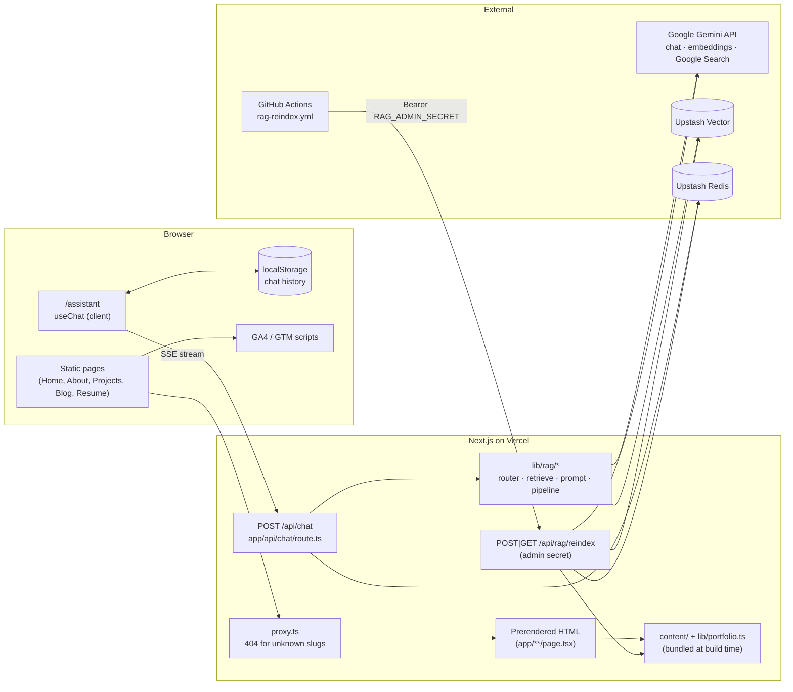
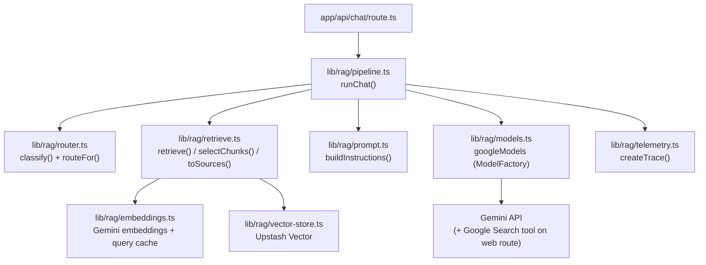
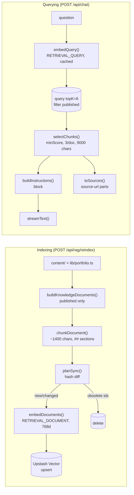
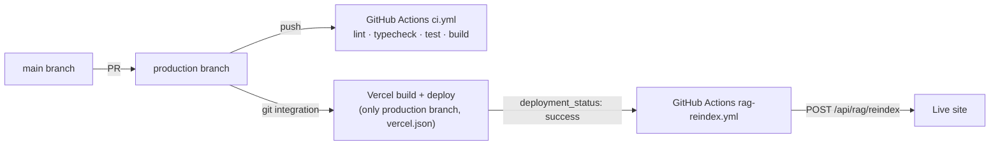
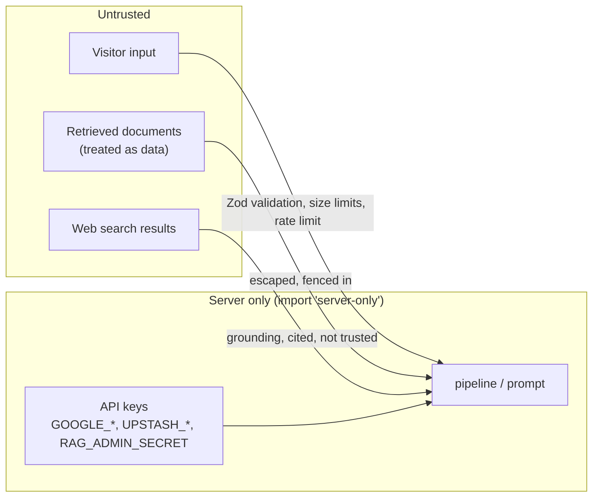

# Project Architecture

> Scope: the code in this repository as of 2026-10-18 (branch `main`, uncommitted work included).
> Every diagram is labelled **Implemented**, **Inferred** or **Proposed**. "Implemented" means the
> code exists and is covered by tests or was exercised locally; it does **not** mean it has run in
> production. See [PROJECT_STATUS.md](PROJECT_STATUS.md) for what has and hasn't been verified.

## 1. Purpose and product requirements

A personal portfolio for Ayush Pathak (Senior Frontend Engineer) that:

1. Presents professional experience, project case studies and technical articles
   (`app/*/page.tsx`, content in `content/` and `lib/portfolio.ts`).
2. Separates verified experience from learning: every project and article carries an
   **evidence label** and a **publication status** (`content/types.ts`).
3. Includes an AI assistant (`/assistant`) that answers questions about the portfolio from
   **published content only**, cites sources, uses web search only for current technical
   questions, and declines out-of-scope or unanswerable questions (`lib/rag/`).
4. Is fast, SEO-friendly and cheap to run on free tiers (static prerendering, Vercel Hobby,
   Upstash and Gemini free tiers).

## 2. Technology stack (from `package.json` / installed versions)

| Area | Package | Installed version | Notes |
|---|---|---|---|
| Framework | `next` | 16.4.0 | App Router, Turbopack, `cacheComponents: true`, `partialPrefetching: true` (`next.config.ts`) |
| UI | `react`, `react-dom` | 19.3.0 | |
| Language | `typescript` | 5.x, `strict: true` | Path alias `@/*` (`tsconfig.json`) |
| Styling | `tailwindcss` | 4.x | Tokens in `app/globals.css`, no `tailwind.config` |
| Components | `shadcn` (`base-nova`) on `@base-ui/react` | 4.21 / 1.9 | Generated into `components/ui/` |
| AI core | `ai` | 7.0.137 | `streamText`, `embed`, `embedMany`, `createUIMessageStream` |
| AI provider | `@ai-sdk/google` | 4.0.93 | Gemma/Gemini chat, Gemini embeddings, Google Search grounding |
| AI UI | `@ai-sdk/react` | 4.0.140 | `useChat` |
| Vector DB | `@upstash/vector` | 1.2.3 | REST client |
| Redis | `@upstash/redis`, `@upstash/ratelimit` | 1.39.0 / 2.2.0 | Rate limiting, index status |
| Validation | `zod` | 4.x | Chat request schema |
| Markdown | `react-markdown` + `remark-gfm` | 10.x / 4.x | Chat answers and articles; raw HTML is not rendered |
| Analytics | `@next/third-parties` | 16.4.0 | `GoogleAnalytics`, `GoogleTagManager` |
| Tests | `vitest` | 5.0.5 | `vitest.config.mts` |

Default chat model: `gemma-4-26b-a4b-it`, overridable with `GEMINI_MODEL` (`lib/model.ts`).

## 3. High-level architecture

**Implemented architecture**

The website itself is almost entirely **static HTML generated at build time**. The only
server code that runs per request is `proxy.ts` (for `/blog/:slug` and `/projects/:slug`),
`/api/chat` and `/api/rag/reindex`.

## 4. Frontend architecture

**What it does.** Renders the portfolio pages and the chat UI.

**Structure.**

- `app/layout.tsx` — root layout: fonts, `metadataBase`, dark-by-default theme script,
  `GoogleTagManager`/`GoogleAnalytics` (only when their env vars are set), `TooltipProvider`.
- `components/page-shell.tsx` — shared layout for content pages: `SiteHeader`, tablet
  `NavRail`, desktop `LinkedSidebar`, phone `MobileNav`.
- Pages are **Server Components** that read content and pass small, serialisable props to
  **Client Components** that need state (filters, search, chat):
  - `app/projects/page.tsx` → `ProjectBrowser` (client) with `ProjectSummary[]`.
  - `app/blog/page.tsx` → `BlogBrowser` (client) with `ArticleSummary[]` (no article bodies).
  - Detail pages `app/projects/[slug]/page.tsx`, `app/blog/[slug]/page.tsx` are fully
    server-rendered (Markdown is rendered on the server by `components/content/markdown.tsx`).
- The assistant (`components/assistant/assistant.tsx`) is a client component using `useChat`.

**Why this shape.** Static pages are fast and SEO-friendly. Keeping content out of client
components avoids shipping every article to the browser (`content/index.ts` imports all
Markdown bodies; it must not be imported from a `"use client"` file — the article list uses
`toArticleSummary()` instead).

**Failure modes.** A client component importing `@/content` would silently bloat the bundle.
A server→client prop containing a function (e.g. a Lucide icon component) fails at build time —
that's why content stores icons as string `IconKey`s mapped by `components/content/content-icon.tsx`.

**Alternatives.** MDX or a headless CMS for content; client-side data fetching. Rejected for now
because the content set is small and changes only with deploys (see
[CONTENT_ARCHITECTURE.md](CONTENT_ARCHITECTURE.md)).

## 5. Backend / API architecture

| Endpoint | File | Purpose | Auth |
|---|---|---|---|
| `POST /api/chat` | `app/api/chat/route.ts` | Streams assistant answers (SSE, AI SDK UI message protocol) | Public, rate-limited |
| `POST /api/rag/reindex` | `app/api/rag/reindex/route.ts` | Syncs the vector index with published content | `Authorization: Bearer <RAG_ADMIN_SECRET>` |
| `GET /api/rag/reindex` | same | Returns the last indexing report | Same |
| `proxy.ts` | root | Returns 404 for slugs without a public page | n/a |

There are **no Server Actions, no database writes from users, no authentication of visitors**.

`/api/chat` is deliberately thin: it rate-limits, parses, and delegates to
`runChat()` in `lib/rag/pipeline.ts`, wiring real providers through `getChatDeps()` in
`lib/rag/service.ts`. This dependency injection is what makes the pipeline testable with fakes
(`tests/rag/pipeline.test.ts`).

**Failure handling.** Pre-stream failures return JSON with an HTTP status
(400/413/429/500). Failures after streaming starts are sent as an `error` chunk with a safe
message (see [RELIABILITY_AND_DEBUGGING.md](RELIABILITY_AND_DEBUGGING.md)).

## 6. AI integration architecture

**Implemented architecture**

Key properties:

- **Routing happens in code before any model call** (`classify`, `routeFor`).
- **Web search is a capability given per request**, not a tool the model can choose freely:
  `deps.models({ webSearch: route === "web_search" })`.
- **Personal questions never get web search**, in any mode (`routeFor` returns
  `personal_rag` for `personal`).
- **The model has no tools that write data or run code.** The only tool is Google Search
  grounding on the web route.

Alternatives (LLM-based routing, agent loops with tool choice) are discussed in
[ROUTING_AND_TOOLS.md](ROUTING_AND_TOOLS.md).

## 7. RAG architecture

**Implemented architecture** (indexing and querying share the chunking and embedding setup)

Full explanation: [RAG_DEEP_DIVE.md](RAG_DEEP_DIVE.md).

**Important current state:** Upstash is **not configured** in this repository's `.env.local`
(only the Gemini key is set). Until it is, `isVectorStoreConfigured()` returns false and
personal questions use the `fallback` route: core profile documents are sent in full
(`fallbackChunks()` in `lib/rag/service.ts`). The vector index has never been populated, and
`npm run rag:eval` has never run against real providers.

## 8. Content storage and ingestion architecture

- **Source of truth:** TypeScript and Markdown files in the repository —
  `content/projects/*.ts`, `content/articles/index.ts` + `content/articles/*.md`,
  `lib/portfolio.ts`. There is no CMS or database for content.
- **Rendering:** imported at build time; Markdown is imported as a raw string via the Turbopack
  rule `"*.md": { type: "raw" }` in `next.config.ts`.
- **Ingestion trigger:** `.github/workflows/rag-reindex.yml` runs on GitHub
  `deployment_status` events with state `success` and environment `Production`, or manually,
  and calls the reindex endpoint via `scripts/rag-reindex.mjs`. **This workflow has not run
  yet** — it requires the `RAG_ADMIN_SECRET` secret and `SITE_URL` variable in GitHub and the
  Vercel GitHub integration reporting deployments with the environment name `Production`
  (an assumption to verify on the first deploy).

Details: [CONTENT_ARCHITECTURE.md](CONTENT_ARCHITECTURE.md).

## 9. Analytics architecture

- GA4 via `GoogleAnalytics` and GTM via `GoogleTagManager` in `app/layout.tsx`, each rendered
  only when `NEXT_PUBLIC_GA_ID` / `NEXT_PUBLIC_GTM_ID` is set.
- Custom events through `trackEvent()` in `lib/analytics.ts`, which sends to both GA
  (`sendGAEvent`) and GTM (`sendGTMEvent`) when configured.
- AI request metrics are **not** sent to analytics; they're server logs
  (`createTrace()` in `lib/rag/telemetry.ts`).

Details: [ANALYTICS_AND_OBSERVABILITY.md](ANALYTICS_AND_OBSERVABILITY.md).

## 10. Deployment architecture

**Inferred architecture** (from `vercel.json`, the workflows and the README; the Vercel project
settings themselves are not in the repository)

- `vercel.json` disables deployments for every branch except `production`.
- CI and Vercel run independently: Vercel does not wait for CI. A failing CI run doesn't block
  a deploy unless branch protection is configured (README TODO).
- Function limits: `maxDuration = 60` for `/api/chat` and `/api/rag/reindex`.

## 11. Security boundaries

- Secrets are read only in server modules; `lib/rag/embeddings.ts`, `vector-store.ts`,
  `models.ts`, `service.ts`, `index-status.ts`, `lib/redis.ts`, `lib/rate-limit.ts` and
  `lib/admin-auth.ts` import `server-only`, which makes a client import fail the build.
- Only `NEXT_PUBLIC_*` variables reach the browser (GA ID, GTM ID, site URL).
- Drafts are excluded from the build output's public pages (`isVisible()`), the sitemap, the
  index (`buildKnowledgeDocuments()`, `documentProblem()`), and queries
  (`filter: "publicationStatus = 'published'"`).

Full review: [SECURITY_REVIEW.md](SECURITY_REVIEW.md).

## 12. External service dependencies

| Service | Used for | Required? | If unavailable |
|---|---|---|---|
| Google Gemini API | Chat generation | Yes for chat | Route returns 500 `notConfigured` if key missing; provider errors become a safe error message |
| Gemini embeddings | Query + document embeddings | Only with RAG | Retrieval fails → personal: "knowledge base unavailable" reply; technical: general answer |
| Google Search grounding | Current technical questions | Optional | Falls back to an answer without search, flagged `searchUnavailable` |
| Upstash Vector | Retrieval | Optional (fallback exists) | Same as embeddings failure |
| Upstash Redis | Rate limiting, index status | Optional | In-memory per-instance limiter; status not persisted |
| GitHub Actions | Post-deploy reindex | Optional | Index goes stale until manual `npm run rag:reindex` |
| Vercel | Hosting | Yes | Site down |
| GA4 / GTM | Analytics | Optional | No analytics; site unaffected |

## 13. Current limitations and technical debt

Confirmed by reading the code (details and severity in [PROJECT_STATUS.md](PROJECT_STATUS.md)):

1. RAG has never run against real Upstash; thresholds (`RAG_MIN_SCORE=0.6`,
   `RAG_SCOPE_OVERRIDE_SCORE=0.7`) are untuned defaults.
2. All 15 articles are drafts, so **no article is in the knowledge base**; technical questions
   currently fall through to general model knowledge.
3. On the web-search route, portfolio chunks are sent to the model but not cited
   (`generate()` skips `toSources` when `route === "web_search"`).
4. Off-topic questions still cost one embedding + one vector query, because retrieval decides
   whether an `unknown` question is rescued.
5. `listHashes()` downloads every vector's metadata including chunk text — fine for hundreds of
   chunks, wasteful at thousands.
6. A chunk hash doesn't include `updatedAt`, so a date-only change doesn't refresh stored
   metadata.
7. Rate limiting falls back to per-instance memory without Redis.
8. Blog/chat search terms are sent to GA as `search_term` (privacy consideration; see the
   security review).
