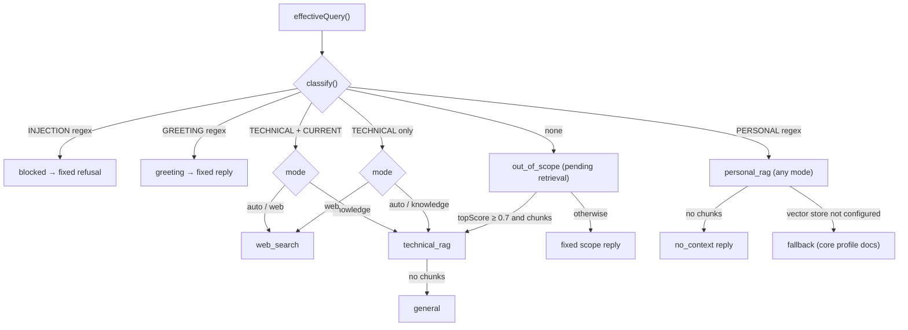
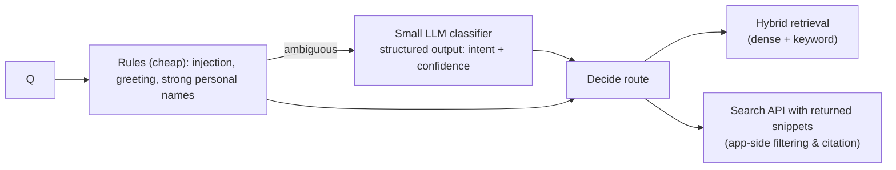

# Routing, Hybrid RAG, Web Search and Scope Control

## 1. What exists: rule-based routing with a retrieval override

Routing is **rule-based** (regular expressions in `lib/rag/router.ts`) with **one
retrieval-based override** (in `lib/rag/pipeline.ts`). No model is used to route.

**Implemented architecture**



### `classify(question)` — order matters
```ts
if (INJECTION.test(q)) return "blocked"
if (GREETING.test(q)) return "greeting"
if (PERSONAL.test(q)) return "personal"
const technical = TECHNICAL.test(q)
if (technical && CURRENT.test(q)) return "current"
if (technical) return "technical"
return "unknown"
```

- **INJECTION** — "ignore/disregard/forget/override … instructions/rules/prompt",
  "reveal/show/print … system/hidden/developer prompt", "verbatim", "developer mode",
  "jailbreak". Deliberately does *not* match "API key" or "secret" (those are legitimate
  technical questions; secrets are never in the model's context anyway).
- **GREETING** — the whole message is a greeting or thanks.
- **PERSONAL** — pronouns (`you`, `your`, `he`, `his`, `him`…), strong signals (`resume`, `cv`,
  `hire`, `linkedin`, `mentor`…), plus **names generated from content**: full name, first name,
  "pathak", every company in `PORTFOLIO.experience`, every project title and `aka`. Adding a
  project automatically teaches the router its name.
- **TECHNICAL** — ~150 frontend/AI terms.
- **CURRENT** — *latest/newest/what's new/release/changelog/deprecated/today/this year*, version
  numbers like `16.4`, years 2020–2099.

### `routeFor(intent, mode)`
| Intent | auto | knowledge | web |
|---|---|---|---|
| personal | personal_rag | personal_rag | personal_rag |
| current | web_search | technical_rag | web_search |
| technical | technical_rag | technical_rag | web_search |
| unknown | out_of_scope* | out_of_scope* | out_of_scope* |
\* resolved after retrieval.

Tests: `tests/rag/router.test.ts` (23 classification cases, route table),
`tests/rag/eval-routing.test.ts` (all 16 evaluation questions).

## 2. How each source is used

| Route | Context given to model | Tools | Citations | UI label |
|---|---|---|---|---|
| personal_rag | Selected chunks | none | Portfolio pages | From my portfolio |
| technical_rag | Selected chunks | none | Portfolio pages | From my portfolio |
| fallback | All core profile chunks | none | Portfolio pages | From my portfolio |
| general | `(none)` | none | none | General knowledge |
| web_search | Selected chunks (if any) | Google Search | Web results only | Web search |
| no_context / out_of_scope / blocked / greeting | — (no model) | — | — | No matching information / none |

## 3. When neither source has enough evidence

- Personal: fixed `noContext` reply — the model is never asked.
- Technical with no portfolio match: answered from general knowledge and labelled as such. This
  is a product choice: the assistant is scoped to "frontend and AI engineering topics", not only
  to Ayush's content.
- Web route where search fails: answered without search, flagged. **Gap:** the model may still
  answer a "latest version" question from stale memory; the prompt tells it to say the answer
  may be out of date, but nothing verifies that it did.

## 4. Untrusted content and prompt injection

- User text: injection regex (casual attempts only); validation; no client `system` messages.
- Retrieved documents: escaped and wrapped in `<document>` tags; instructions say documents
  are data. All documents are authored by Ayush, so the risk is low.
- Web results: the provider grounds the answer on them; the instructions say to treat them as
  untrusted and never use them for facts about Ayush. **The application never sees or filters
  web page text** — grounding happens inside Google's API — so injection via web pages can only
  be mitigated by instructions and by the absence of dangerous capabilities.
- **No tool can act**: no code execution, no writes, no browsing beyond grounding. The worst case
  of a successful injection is wrong or off-brand text, not data loss.

## 5. Can it answer beyond its intended scope?

Yes, in limited ways (confirmed by reading the code):
1. Any message containing a technical term is in scope, e.g. "Write a poem about React" is
   `technical` and will be answered by the model.
2. Personal pronouns make anything "personal": "What do you think about cricket?" →
   `personal_rag` → usually `no_context` (good), but if retrieval finds a weak-but-above-threshold
   chunk, the model gets that chunk and may answer loosely.
3. The model's own refusal ("politely decline anything else" in `BASE_RULES`) is the second
   line of defence.

## 6. Tool calling: what is and isn't implemented

- **Implemented:** Google Search grounding as a provider tool on the web route only
  (`google.tools.googleSearch` for `gemini-*`, request-body injection for Gemma in
  `lib/rag/models.ts`).
- **Not implemented:** custom tools (`tool({...})`), multi-step tool loops (`stopWhen`),
  structured outputs, generative UI, agents. The articles on these topics are labelled
  "Learning Notes" for that reason.

## 7. Recommended routing design (Proposed — not implemented)

**Proposed architecture**



Ideas, in order of value:
1. Only use retrieval to rescue `unknown` questions when the query has ≥ 3 content words (saves
   quota on "lol", "pasta recipe").
2. Cite portfolio chunks on the web route too (or don't send them).
3. Add a tiny LLM classifier only for ambiguous cases, with structured output and a cache.
4. Replace provider grounding with a search API that returns snippets, so the app can filter
   domains and control citations (trade-off: more code, another quota).
